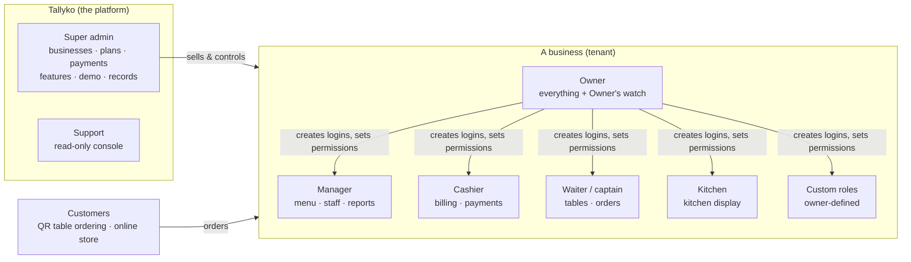
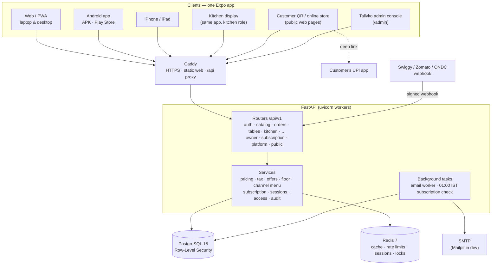
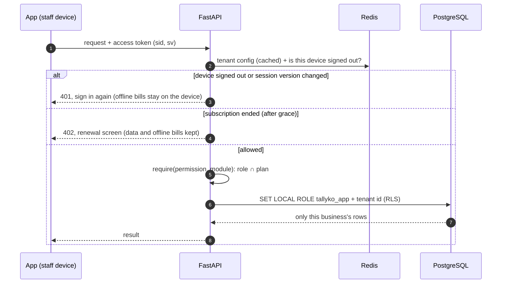
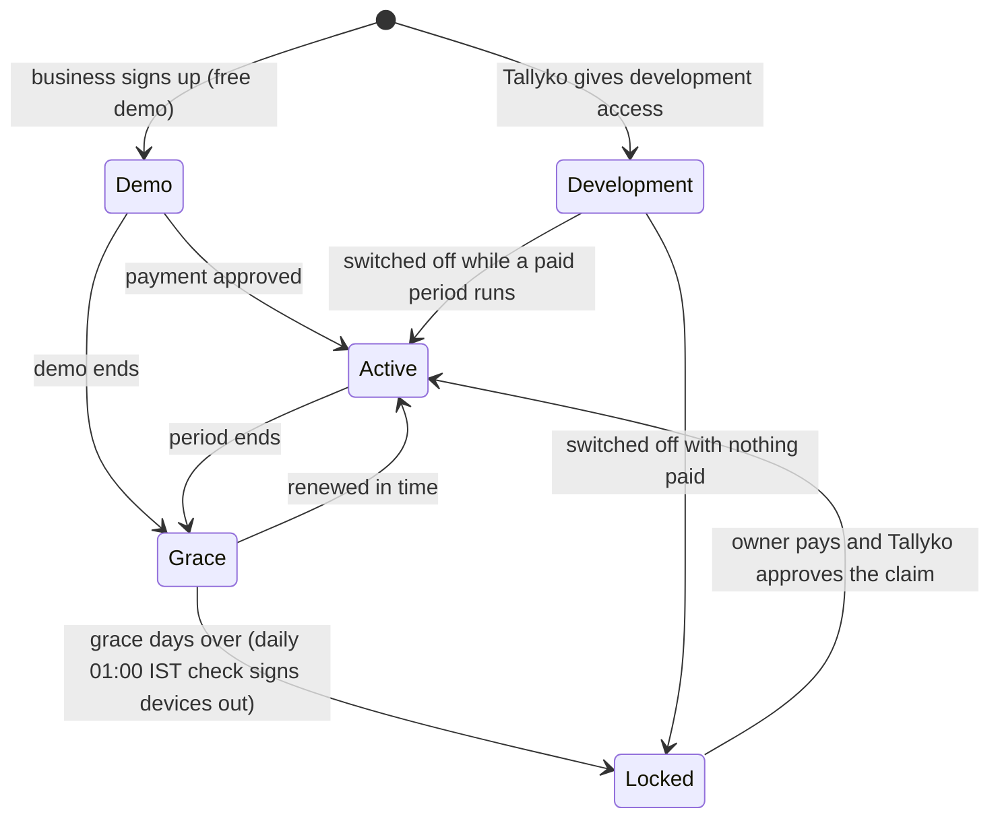

# Tallyko

**A point of sale built for Indian shops that are busy all day.** One codebase runs on a laptop or desktop browser, on Android tablets and phones, and on iPhone and iPad. It covers everything from a one-counter kirana to a large restaurant, café, cloud kitchen or retail store.

It keeps billing when the internet drops, prints to inexpensive Bluetooth receipt printers, charges GST correctly, and is built entirely on free, open-source tools.


---

## Contents

1. [The product](#1-the-product)
2. [Who uses it: roles](#2-who-uses-it-roles)
3. [Features](#3-features)
4. [How it works](#4-how-it-works)
5. [Tech stack](#5-tech-stack)
6. [Run it locally](#6-run-it-locally)
7. [Demo logins](#7-demo-logins)
8. [Get it on devices](#8-get-it-on-devices)
9. [Deploy for real](#9-deploy-for-real)
10. [Repository layout](#10-repository-layout)
11. [Working on the code](#11-working-on-the-code)
12. [Documentation, diagrams and versions](#12-documentation-diagrams-and-versions)

---

## 1. The product

**The problem.** Shop owners in India juggle several things at once:
- counter bills during a rush;
- table orders and the kitchen;
- Swiggy and Zomato orders, often priced differently from the counter;
- GST rules that change;
- staff who can quietly cancel bills;
- an internet connection that is not always there.

Most POS software is slow at peak hours, breaks offline, or hides what staff did.

**Tallyko's promises:**

| Promise | What it means in practice |
|---|---|
| **Fast at rush hour** | Frequent actions take one tap. Billing works from the keyboard and barcode scanner on a desktop. Lists stay smooth with 10,000 rows. The whole UI follows [docs/20](./docs/20_High_Volume_UX.md). |
| **Never stops billing** | Bills made offline are saved on the device and sync later without duplicates, even if the subscription lapsed in between. |
| **Honest records** | Nothing a business does can delete a bill, payment or customer: the database refuses it. The owner sees every cancellation, removal, discount and price change, with who did it. |
| **Right on tax** | GST comes from dated tax classes. Rate changes are scheduled ahead of time, and every bill line keeps its own tax snapshot. GST is charged only when a valid GSTIN is set; otherwise the bill is a Bill of Supply. |
| **One product, every device** | Web/PWA, Android and iOS from one Expo codebase. Kitchen screens, customer QR menus and the Tallyko admin console are all part of it. |
| **Free to run** | Only free, open-source software and free services: Caddy, Let's Encrypt, RapidOCR, local Docker builds. No paid APIs or trials. |

**Who it is for.** Restaurants and dhabas, cafés, cloud kitchens selling on Swiggy, Zomato and ONDC, QSRs, and retail and kirana stores. It suits a single owner on a phone and a chain with many staff and devices.

**The business model.** Tallyko sells subscriptions to businesses: Basic, Standard and Pro plans, with monthly, quarterly or yearly pricing and promotional offers.
- A new business gets a **free demo**; its length is set by the Tallyko super admin.
- The owner renews by UPI or bank transfer and submits the reference. Tallyko approves it in the admin console.
- When a subscription ends, the business sees a renewal screen. Its data, and any bills waiting on devices, are kept safe.

---

## 2. Who uses it: roles



| Role | Where they work | What they can do |
|---|---|---|
| **Super admin** (Tallyko) | `/admin` console | Onboard businesses, plans and prices, per-business feature switches, record payments, approve "I've paid" claims, give a demo or development access, sign devices out, archive or delete records on request, GST library, platform settings. Never sees billing screens. |
| **Support** (Tallyko) | `/admin` console | Everything above, read-only. |
| **Owner** | The whole app | Everything, including roles and permissions, modules, GST, subscription, signed-in devices, and **Owner's watch**: every cancellation, removal, comp, discount and menu change, by staff member. |
| **Manager** | Most of the app | Menu, stock, customers, offers, reports and staff (not owners or managers). Can't see the owner's watch list. |
| **Cashier** | Billing, orders, customers | Take orders, collect payments, give allowed discounts, reprint, accept online orders, mark kitchen items ready or served. |
| **Waiter / captain** | Tables, billing | Take table orders and send KOTs, serve any running table, mark items served. Cannot take payments or cancel items the kitchen already has. |
| **Kitchen** | Kitchen display | See tickets and move items through New → Preparing → Ready, bump tickets, recall. |
| **Custom roles** | Owner-defined | Any mix of about 30 permissions, for example "Billing only" or "Captain". |
| **Customers** | Phone browser | Scan the table QR, order on their own bill, pay at the counter or by UPI, track the order. |

What a person can do is **their role's permissions** ∩ **the modules in the business's plan**, minus the modules the owner switched off. The server enforces this on every request, and the app hides what isn't allowed. See [feature 013](./docs/features/013_Staff_Roles_And_Access.md).

---

## 3. Features

| Area | Highlights |
|---|---|
| **Billing (POS)** | Touch, keyboard and barcode-scanner friendly. Grid or list. Split payments, cash change and quick-cash notes, UPI QR, credit (udhaar), discounts, offers. Bill barcodes. Works offline. |
| **Restaurant floor** | Tables with live tiles showing seated time, amount, ready-to-serve and the waiter. **Several bills per table**. KOTs with per-item status. Re-order as a new KOT. Partial cancel with reason and wastage. On the house. Split, merge and transfer. |
| **Kitchen display** | Columns New / Preparing / Ready. Tap an item to move it on, bump the ticket, recall. New-ticket sound. Cancelled items marked "DON'T MAKE". Large-text and full-screen modes. Alert times set by the business. |
| **Table QR ordering** | Customers scan, see the menu, and order on their own bill. Staff confirm, or orders go straight to the kitchen. The customer pays at the counter or by **UPI**: a deep link, then "I've paid", then staff confirm. |
| **Online orders** | Swiggy, Zomato, ONDC and magicpin inbox (manual entry or signed webhook). Commission per channel. **Each item can have its own price per app, or be hidden there.** Own online store. Cloud-kitchen virtual brands. |
| **Menu** | Variants (Half/Full), categories, barcodes and labels. **Menu from a photo** (free offline OCR). Bulk edits: price, tax, category, app prices, hide or show. **Version history with restore.** |
| **GST & tax** | Tax classes with CGST/SGST or IGST and HSN/SAC. Dated rate changes (e.g. GST 2.0). Composition and unregistered → Bill of Supply. GSTIN validated with its check digit. |
| **Inventory** | Stock in and out with one tap and undo, low and out-of-stock filters, wastage, history, barcode lookup. |
| **Customers & loyalty** | Saved from bills. Points, tiers, visits. Offers and loyalty rewards (e.g. 5 visits → 20% off). Email templates with consent. |
| **Reports** | Sales, GST, payment methods, channels net of commission, hourly, items, **staff performance**, day-end, CSV export. |
| **Owner controls** | Owner-only watch list. Nothing deleted by a business. Corrections only through a request to Tallyko. Signed-in devices. Activity log. |
| **Tallyko console** | Businesses with access state (demo / development / active / grace / locked), plans and pricing options, subscription offers and coupons, payment claims, owner requests, sessions, the daily 01:00 IST subscription check, GST library. |

Every feature has a spec in [`docs/features/`](./docs/features/). The [versions folder](./docs/versions/README.md) tracks which release shipped what.

---

## 4. How it works

### System at a glance



### Every request, in order



### What happens when a bill is made

```mermaid
flowchart LR
  A["Cashier adds items<br/>(ids + quantities only)"] --> B["Price on this channel<br/>own app price or mark-up"]
  B --> C["GST class in effect now<br/>(only with a valid GSTIN)"]
  C --> D["Offer engine<br/>best eligible offer"]
  D --> E["Manual discount<br/>(permission + audit)"]
  E --> F["GST on the discounted value<br/>CGST+SGST or IGST"]
  F --> G["Round to the rupee"]
  G --> H["Each line keeps its<br/>price + GST snapshot"]
  H --> I["Payment completes the bill<br/>invoice no. · stock · loyalty · email"]
```



The server prices every bill; the device only sends product ids and quantities. If the internet is down, the bill is saved in the device's **outbox** with its own id. It syncs later, and sending it twice never creates two bills.

### Subscription life cycle



More diagrams, in both Mermaid (`.mmd`) and draw.io: **[docs/diagrams](./docs/diagrams/README.md)**. They cover architecture, deployment, data isolation, access, the order and kitchen-item lifecycles, offline sync, QR ordering, subscriptions, records and audit.

**Database:** [Tallyko_Database_ERD.drawio](./docs/diagrams/Tallyko_Database_ERD.drawio) has every table and every column, generated from the models, with one page per area. A [PNG preview](./docs/diagrams/rendered/Tallyko_Database_ERD.png) is also available. Regenerate it after a schema change:

```bash
docker compose exec -T backend python -m app.db.erd_drawio > docs/diagrams/Tallyko_Database_ERD.drawio
```

---

## 5. Tech stack

| Layer | Choice | Why |
|---|---|---|
| App (web, Android, iOS) | **Expo SDK 57**, React Native 0.86, React 19, TypeScript, expo-router, zustand | One codebase for every device; installable PWA on desktop. |
| UI | Own design system plus high-volume building blocks (ActionMenu, SelectionBar, virtualised DataList, FilterBar, StatusPill, hotkeys) | Fast, consistent screens for busy counters. |
| Offline | Device cache plus an outbox of bills with client-generated ids | Billing never stops; replays are idempotent. |
| Printing | ESC/POS over Bluetooth Classic, BLE or Web Bluetooth, or the print dialog; Code128, EAN-13 and QR | Works with cheap thermal printers. |
| API | **FastAPI** (Python 3.11), SQLAlchemy 2 async, Pydantic, PyJWT, bcrypt (in worker threads) | Fast, typed and well documented (`/docs`). |
| Database | **PostgreSQL 15** with **Row-Level Security** | Every business's data is isolated by the database itself. A restricted role refuses deletes of business records. |
| Cache & coordination | **Redis 7** | Tenant config cache, rate limits, signed-out sessions, daily-job lock. |
| Migrations | Alembic through `manage.py` (one migration per table) | Predictable, reviewable schema history. |
| Background work | In-process asyncio tasks (email worker, 01:00 IST scheduler) | No extra worker service to run. |
| OCR | **RapidOCR** (ONNX), offline | Menu from a photo with no paid API. |
| Email | Any SMTP; **Mailpit** in development | Free; nothing leaves your machine in dev. |
| Edge | **Caddy** with automatic HTTPS (Let's Encrypt) | Free TLS and simple config. |
| Builds & CI | Docker Android builder (APK/AAB), optional EAS for iOS, GitHub Actions | Everything reproducible in Docker. |

Rationale and alternatives: [docs/01_Tech_Stack_And_Justification.md](./docs/01_Tech_Stack_And_Justification.md).

---

## 6. Run it locally

Everything runs in Docker; nothing needs to be installed on your machine except Docker.

```bash
docker compose up -d --build
docker compose exec backend python manage.py seed
```

| What | Where |
|---|---|
| Web app (live reload) | http://localhost:8081 |
| API + Swagger docs | http://localhost:8000/docs |
| Dev email inbox (Mailpit) | http://localhost:8025 |
| Postgres (local tools) | `127.0.0.1:5433` |
| Production build preview | `docker compose --profile preview up -d --build` → http://localhost:8080 |

Live reload on Windows and macOS: run `docker compose up --watch`. Compose Watch copies frontend edits into the container; the backend reloads by itself.

```bash
docker compose exec backend python -m pytest -q                      # backend tests (own test database)
docker compose exec web npx tsc --noEmit -p . && docker compose exec web npx jest   # frontend checks
docker compose exec backend python manage.py status                  # migrations
docker compose exec backend python manage.py fresh --seed --force    # dev only: rebuild the dev database
```

---

## 7. Demo logins

The login screen has a **demo account dropdown** in development builds. Every demo account uses the password **`Demo@1234`**.

| Login | Business | Shows |
|---|---|---|
| `superadmin@example.com`, `superadmin2@example.com` | Tallyko | Admin console: businesses, plans, payments, offers, records |
| `support@example.com`, `support2@example.com` | Tallyko | Read-only console |
| `owner.dhaba@example.com` | Sharma Da Dhaba | Restaurant: 12 tables, kitchen, QR ordering, everything |
| `owner.store@example.com` | Gupta General Store | Retail: barcodes, stock |
| `owner.cloud@example.com` | Biryani Box Cloud Kitchen | Swiggy, Zomato and ONDC with different prices and menus; two brands |
| `owner.expired@example.com` | Chai Point Café | Subscription ended: renewal screen and a pending payment claim |
| `manager1@`, `manager2@`, `cloud.manager@example.com` | Dhaba / Cloud kitchen | Manager |
| `cashier1@`, `cashier2@`, `cashier.expired@example.com` | Dhaba / Café | Cashier (the café one is locked) |
| `waiter1@`, `waiter2@example.com` | Dhaba | Waiter |
| `kitchen1@`, `kitchen2@`, `cloud.kitchen@example.com` | Dhaba / Cloud kitchen | Kitchen display |

Demo businesses run on **development access**, so they never lock. Demo data never seeds in production.

---

## 8. Get it on devices

| Platform | How |
|---|---|
| **Laptop / desktop** | Open the web app in Chrome or Edge, then *Install app* (PWA). Print over Web Bluetooth (BLE printers) or the system print dialog (USB printers). |
| **Android (share an APK)** | `docker compose --profile android run --rm android-build` → `dist/tallyko-<version>.apk`. Set `APK_API_URL` in `.env` to your server first. |
| **Google Play** | The same build produces `dist/tallyko-<version>.aab` to upload in Play Console. |
| **iPhone / iPad** | Free: Safari → Share → *Add to Home Screen*. App Store and TestFlight builds need an Apple Developer account and EAS Build (`eas.json` is ready). |

Store rules (target SDK, account deletion, privacy manifest, permissions) are tracked in [docs/18](./docs/18_App_Store_And_Play_Compliance.md).

---

## 9. Deploy for real

```bash
cp .env.example .env     # set DOMAIN, JWT_SECRET, POSTGRES_PASSWORD, SMTP_* (optional)
docker compose -f docker-compose.prod.yml up -d --build
docker compose -f docker-compose.prod.yml exec backend python manage.py create:superadmin you@company.com
```

- Caddy serves the app and API with automatic HTTPS.
- The backend migrates the database on start and runs `WEB_CONCURRENCY` workers.
- The daily subscription check runs once across all workers.
- It runs on a shop PC (works on shop Wi-Fi with no internet) or on a permanently free cloud VM. See [docs/17](./docs/17_Free_Cloud_Deployment.md).
- Backups: `scripts/backup_db.sh` or `scripts/backup_db.ps1`.

---

## 10. Repository layout

```text
backend/                 FastAPI API
  app/api/               routers (thin): auth, catalog, orders, tables, kitchen, inventory, crm, reports, admin,
                         access, offers, email, taxes, subscription, owner, platform, sync, public, integrations, ai
  app/services/          business rules: pricing, tax, offers, order & floor, channel menu, menu history,
                         subscription, sessions, access, records admin, email, audit, OCR
  app/models/            SQLAlchemy models by area (38 tables)
  app/db/                manage.py commands, RLS SQL, seeders
  alembic/versions/      one migration per table
  tests/                 unit + integration (real Postgres/Redis, own test database)
frontend/                Expo app: web + Android + iOS
  src/app/               routes (expo-router)
  src/features/<area>/   screens: pos, ops, catalog, customers, offers, reports, owner, settings, admin, public, …
  src/components/ui/     design system + high-volume building blocks
  src/store, src/lib, src/hooks, src/api
docs/                    product, architecture, feature specs, diagrams (Mermaid + draw.io), versions
docker-compose.yml       local development (db, cache, mailpit, backend, web)
docker-compose.prod.yml  production (db, cache, backend, Caddy web)
scripts/                 setup, db (manage.py wrapper), backup / restore
```

---

## 11. Working on the code

- **Rules for contributors and AI agents:** [CLAUDE.md](./CLAUDE.md). It covers tenant isolation, "server prices everything", nothing deleted by a business, GST, migrations and the UI standard.
- **Migrations and seeders:** `manage.py` with migrate, rollback, make:migration, db:sync, seed and more. See [docs/19](./docs/19_Database_Migrations.md).
- **UI:** every screen follows the [high-volume UI standard](./docs/20_High_Volume_UX.md). It must be checked at phone, tablet and desktop sizes.
- **Releases:** `VERSION`, [CHANGELOG.md](./CHANGELOG.md), `changelog/vX.Y.Z.md` and [docs/versions](./docs/versions/README.md).

---

## 12. Documentation, diagrams and versions

| Where | What |
|---|---|
| [docs/README.md](./docs/README.md) | Guide to all documentation, with a reading order for each reader |
| [docs/features/](./docs/features/) | One spec per feature: business explanation plus developer notes |
| [docs/diagrams/](./docs/diagrams/README.md) | Mermaid (`.mmd` + rendered SVG) and draw.io diagrams |
| [docs/versions/](./docs/versions/README.md) | What each release contains, feature by feature, and what is planned next |
| [CHANGELOG.md](./CHANGELOG.md) | Release index |
