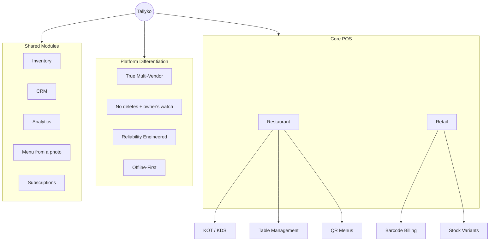

# Product Overview: Tallyko

## 1. Introduction

**Tallyko** is a next-generation, all-in-one POS (Point of Sale) and business management platform designed to serve both restaurants (including cafés and cloud kitchens) and retail businesses (grocery, pharmacy, clothing, etc.). 

We are building Tallyko to directly compete with and surpass existing solutions like Shopto. While Shopto offers a broad feature set, real user feedback highlights critical weaknesses: trust issues around pricing, multi-day outages, and severe performance regressions after updates. Tallyko addresses these flaws structurally while introducing a highly scalable, true multi-vendor architecture and a significantly refined user experience.

## 2. Core Feature Parity (The Baseline)

Tallyko will match Shopto's core capabilities from day one:

**Restaurant-side:**
*   POS billing with GST, handling dine-in, takeaway, and delivery orders.
*   Auto-generation of Kitchen Order Tickets (KOT) and a comprehensive Kitchen Display System (KDS).
*   QR-code digital menus for customer self-ordering.
*   Table management, open orders, several bills per table, split and merge bills. *(Reservations: not built.)*
*   A commission-free online ordering website unique to each business.

**Retail-side:**
*   Barcode and SKU billing, stock variant management, and one-tap checkout.
*   Flexibility to handle grocery, supermarket, pharmacy, clothing, mobile/electronics, salons, and kirana stores.

**Shared Modules:**
*   **Inventory Management:** Real-time stock ledger, low-stock alerts, stock received (with cost), and wastage tracking.
*   **Billing:** Comprehensive GST billing, invoicing, and automated tax reporting.
*   **Analytics:** Detailed daily/weekly/monthly sales, best-sellers, staff/shift performance, and wastage reports.
*   **Menu from a photo:** Menu/product listings from photographed menus (free, on-server OCR; images only, Latin script).
*   **CRM & Loyalty:** Auto-saved customer records, order history, loyalty points, offers and customer emails.
*   **Hardware Support:** Compatibility with Bluetooth thermal printers (2" and 3").
*   **Cross-Platform Access:** One app for laptop/desktop browsers (PWA), Android and iOS; owners, staff, the kitchen display and the Tallyko console all use it.

## 3. How We Differ (The Tallyko Advantage)

Tallyko isn't just about matching features; it's about fundamentally superior engineering and user experience. 

### A. True Multi-Vendor SaaS Architecture
Unlike single-business-per-install models, Tallyko is built as a multi-tenant SaaS platform from day one. 
*   **Tenant Isolation:** Each vendor gets an isolated workspace (products, staff, tables, reports).
*   **Database Flexibility:** Tenants share a central database with Postgres Row-Level Security. The routing layer can also point a vendor at a **dedicated database instance**; provisioning for that is not built yet.

### B. Reliability by Design
Shopto users have suffered from multi-day outages and broken updates. Tallyko treats reliability as a first-class feature:
*   **Offline-First POS:** Billing continues to work seamlessly without internet connectivity, syncing automatically when restored.
*   **Engineered Resilience:** Health checks with automatic container restarts, graceful degradation (Redis or SMTP down never stops billing), and forward-only migrations so a release can be rolled back.
*   **Safe Updates:** Versioned API contracts (`/api/v1` is only extended) so new releases never break installed apps. *(Staged/canary rollouts: not built.)*
*   **Nothing gets deleted:** businesses can't erase bills or menu history; the owner sees every cancellation, discount and menu change.

### C. Guided, Frictionless UX
Tallyko prioritizes a clean, intuitive interface designed to reduce cognitive load.
*   **Fewer Taps:** Streamlined workflows for common actions like billing, adding stock, and generating KOTs.
*   **In-App Onboarding:** Clear visual hierarchies and contextual tooltips replace the need for external tutorial videos. Tallyko should feel noticeably easier to learn than any competitor.

### D. Advanced Layered Features
We go beyond basic functionality to offer advanced, value-added tools:
*   **Offers engine:** % / ₹ off, free items, item or category offers, loyalty rewards, happy hours, per-channel offers.
*   **Per-channel menus:** different prices and items on Swiggy, Zomato, ONDC, the online store and QR.
*   **GST done right:** dated tax classes, GST only with a valid GSTIN, Bill of Supply otherwise.
*   *Not built yet:* predictive low-stock alerts, pricing suggestions, a combined multi-branch view.

## 4. Initial Target Market
Tallyko is a drop-in replacement tailored equally for:
1.  **Restaurants / Food Service:** Fine dining, cafés, QSRs, cloud kitchens.
2.  **Retail / Commerce:** Grocery stores, pharmacies, clothing boutiques, electronics shops, and local kirana stores.

---

Architecture at a glance: [02_System_Architecture.md](./02_System_Architecture.md) · [system context diagram](./diagrams/mermaid/01_system_context.mmd).

