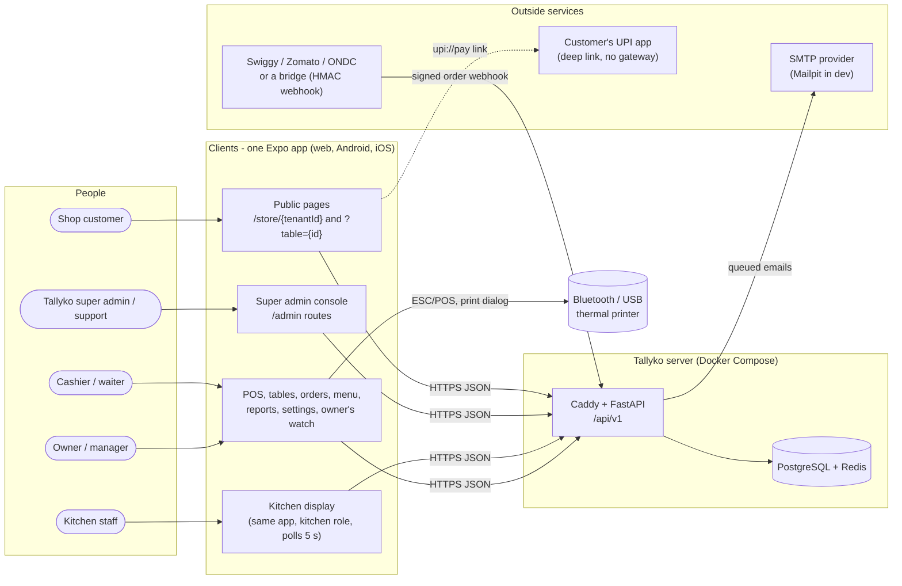

# Tech Stack & Justification

## 1. Constraints

1. **One codebase for every device:** web (laptop/desktop, installable PWA), Android (APK + Play Store), iOS (App Store).
2. **Python backend.**
3. **Docker Compose for everything** — development, preview, Android builds and production.
4. **Free & open source only**, with no paid APIs and no trials (OCR, maps, push etc. must be self-hosted or permanently free).
5. **Multi-tenant** with database-enforced isolation, plus the option of a dedicated database per vendor.
6. **Structured logging** with `tracenest`.

## 2. Selected technologies (v2.0.0)

| Layer | Choice | Why |
|---|---|---|
| App framework | **Expo SDK 57 + React Native 0.86 + React 19**, TypeScript, **expo-router** | One codebase → web, Android, iOS. File-based routing with real URLs on the web (deep links like `/pos?table=…`, public `/store/<id>` pages). Expo's Continuous Native Generation means no hand-maintained `android/`/`ios/` folders. |
| Design system | Own tokens + components (`frontend/src/components/ui`), Inter font, Ionicons | Consistent professional look in light/dark, no heavy UI kit to fight. |
| Client state & offline | **zustand** + AsyncStorage persistence; an **outbox** of client-id'd bills replayed through `/sync/push` | Works identically on web and native; the server treats the client id as an idempotency key, so retries never duplicate a bill. (WatermelonDB was dropped — native-only and heavier than needed.) |
| Secure token storage | **expo-secure-store** (Keychain/Keystore); localStorage on web | Store policies + basic hygiene. |
| Printing | **ESC/POS** encoder in TS; **react-native-bluetooth-classic** (Android SPP printers), **react-native-ble-plx** (BLE, Android/iOS), **Web Bluetooth** (Chrome/Edge), **expo-print** / browser print dialog (AirPrint, USB printers) | Cheap 58/80 mm Indian thermal printers are mostly Bluetooth Classic; iOS only allows BLE; every platform has a print-dialog fallback. |
| Barcodes | Own Code128 / EAN-13 / QR encoders (QR via `qrcode-generator`), **expo-camera** scanning, keyboard-wedge scanner support | Bill barcodes, product labels, UPI QR on bills — offline, no services. |
| Backend | **FastAPI** (async) on Uvicorn, **Pydantic v2** | Fast, typed, automatic OpenAPI docs. |
| Database | **PostgreSQL 15** with **Row-Level Security**, **SQLAlchemy 2 (async)**, **Alembic** | Tenant isolation enforced by the database as a backstop to application filters; forward-only migrations. |
| Cache / rate limiting | **Redis 7** | Sliding-window rate limits, tenant routing cache. Fails open so billing never stops if Redis is down. |
| Auth | **PyJWT** (access + refresh tokens), **bcrypt** | python-jose and passlib were replaced (security advisories / unmaintained). |
| Menu photo OCR | **RapidOCR** (PaddleOCR models on ONNX Runtime, CPU) + own layout parser | Free, offline, far more accurate than Tesseract on photographed menus; ~1 s per photo on CPU; ARM64 wheels for free ARM servers. |
| Web server / TLS | **Caddy 2** | Serves the web build, proxies `/api`, gets free Let's Encrypt certificates automatically. Replaces the planned Traefik (simpler, no Docker-socket access needed). |
| Android builds | Docker image with JDK 17 + Android SDK 36 (`frontend/android.Dockerfile`) | Free, reproducible signed APK/AAB without Android Studio or paid cloud builds. `eas.json` is included for those who prefer EAS. |
| Logging | **tracenest** JSON logs with trace ids | Mandated; each response carries `X-Trace-ID`. |

| Email | Plain **SMTP** (any provider; **Mailpit** in development) with a queue table and an in-process worker | Free tiers of Gmail/Brevo/Zoho work; nothing to pay for or run. |
| Background jobs | **asyncio tasks** in the API lifespan: email worker (`FOR UPDATE SKIP LOCKED`) and the 01:00 IST subscription scheduler (Redis lock) | No broker or worker container needed at this scale. |

Removed from the original plan because nothing used them: Celery/ARQ workers (OCR runs in a thread pool; email and the daily job are in-process tasks), MinIO (no file storage needed — menu photos are processed in memory and not kept), Traefik (replaced by Caddy), WatermelonDB/SQLite on devices (replaced by the zustand cache + outbox).

## 3. Flow

How the pieces connect (containers and services in [02_System_Architecture.md](./02_System_Architecture.md)):

<!-- diagram: 01_system_context drawio=Tallyko_System_Architecture -->

*Diagram source: [`01_system_context.mmd`](diagrams/mermaid/01_system_context.mmd) · [SVG](diagrams/rendered/01_system_context.svg) · draw.io: [`Tallyko_System_Architecture.drawio`](diagrams/Tallyko_System_Architecture.drawio)*
<!-- /diagram -->
