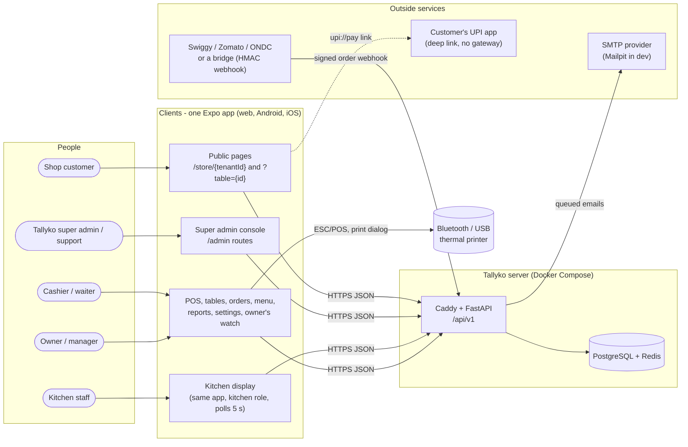
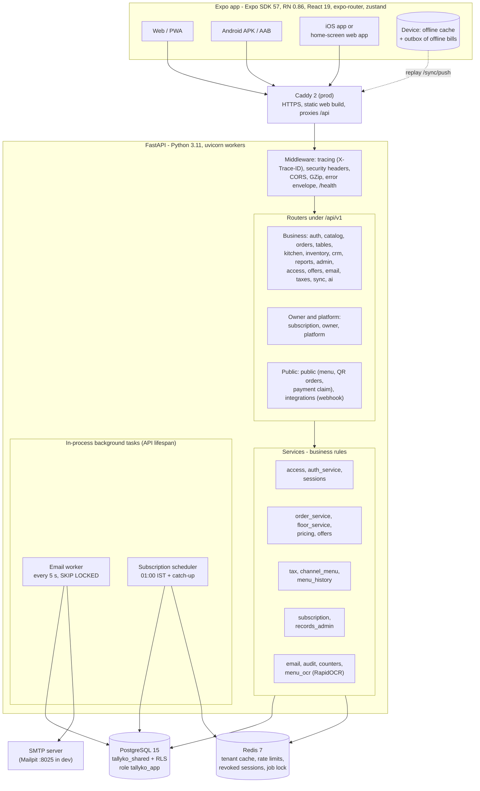

# System Architecture

How Tallyko is built today (v2.0.0). Every diagram here is generated from a file in [`diagrams/`](./diagrams/README.md); when the code changes, change the `.mmd` file and re-run the embed step described there.

## 1. Overview

Tallyko is one Docker Compose stack:

| Tier | What runs | Notes |
|---|---|---|
| Clients | **One Expo app** (SDK 57, React Native 0.86, React 19): web/PWA, Android APK/AAB, iOS app or home-screen web app | Owner, staff, kitchen display and the super admin console are roles and routes in the same app. Public `/store/{tenantId}` pages need no login. |
| Edge | **Caddy 2** (production) | Automatic HTTPS (Let's Encrypt), serves the static web build, proxies `/api` to the backend. In development the Expo dev server (:8081) and the API (:8000) are reached directly. |
| Application | **FastAPI** on uvicorn (`WEB_CONCURRENCY` workers, default 2) | Thin routers under `/api/v1`, business rules in `app/services`. Two **in-process background tasks** start in the API lifespan: the email worker and the daily subscription scheduler. |
| Data | **PostgreSQL 15** with Row-Level Security, **Redis 7** | One shared database; dedicated per-tenant databases are supported in routing only. Redis holds caches, rate limits, revoked sessions and job locks. |
| Outside | Any **SMTP** server (Mailpit in dev), the customer's **UPI app** (deep link), aggregator **webhooks** | No paid APIs: OCR is RapidOCR on the server, there is no payment gateway. |

**Not built** (described in older drafts, removed here): Traefik, Cloudflare WAF, Celery/ARQ worker containers, MinIO/object storage, PgBouncer, a separate React "owner dashboard", SQLite or WatermelonDB on devices, a LAN-only kitchen display protocol, WebSockets. Kitchen and online-order screens poll every 5 s.

## 2. System context

<!-- diagram: 01_system_context drawio=Tallyko_System_Architecture -->

*Diagram source: [`01_system_context.mmd`](diagrams/mermaid/01_system_context.mmd) · [SVG](diagrams/rendered/01_system_context.svg) · draw.io: [`Tallyko_System_Architecture.drawio`](diagrams/Tallyko_System_Architecture.drawio)*
<!-- /diagram -->

## 3. Containers and code structure

<!-- diagram: 02_containers drawio=Tallyko_Master_Architecture -->

*Diagram source: [`02_containers.mmd`](diagrams/mermaid/02_containers.mmd) · [SVG](diagrams/rendered/02_containers.svg) · draw.io: [`Tallyko_Master_Architecture.drawio`](diagrams/Tallyko_Master_Architecture.drawio)*
<!-- /diagram -->

### Routers (`backend/app/api`, all under `/api/v1`)

- **Business:** `auth`, `catalog`, `orders`, `tables`, `kitchen`, `inventory`, `crm`, `reports`, `admin` (settings, modules, channels, brands, staff), `access` (`/access/me`, roles, audit), `offers`, `email`, `taxes`, `sync`, `ai` (menu photo OCR).
- **Owner and platform:** `subscription` (owner renewal; works while locked), `owner` (owner-only watch list and requests to Tallyko), `platform` (super admin console).
- **Public and integrations:** `public` (menu, QR/online orders, UPI payment claim), `integrations` (HMAC-signed aggregator webhook).

See [05_API_Design.md](./05_API_Design.md) for the endpoint map.

### Services (`backend/app/services`)

| Area | Services |
|---|---|
| Access and auth | `access` (permissions × plan modules, `require()`), `auth_service`, `sessions` (devices, revocation) |
| Selling | `order_service` (lifecycle), `floor_service` (item kitchen status, cancel/comp, split/merge, several bills per table), `pricing` (GST engine), `offers` (pure offer engine) |
| Tax and menu | `tax` (`TaxResolver`, dated rates), `channel_menu` (per-channel price and availability), `menu_history` (append-only product versions) |
| Platform | `subscription` (demo/paid/complimentary/development, lock, offers, daily check), `records_admin` (super admin archive and hard delete) |
| Other | `email/` (templates, queue, SMTP worker), `audit`, `counters`, `settings_service`, `menu_ocr` (RapidOCR) |

### Background work

There is no queue broker. Both tasks are `asyncio` tasks created in `app/main.py`'s lifespan, so they run inside every uvicorn worker:

- **Email worker** (`EMAIL_WORKER_ENABLED`): every 5 s reads up to 20 `email_logs` rows with status `queued` using `FOR UPDATE SKIP LOCKED`, so several workers never send the same email. See [014](./features/014_Offers_Loyalty_Rewards_And_Email.md).
- **Subscription scheduler** (`JOB_SCHEDULER_ENABLED`): 01:00 IST daily, with a Redis lock so only one worker runs the check, plus a catch-up on start. See [018](./features/018_Subscriptions_Demo_And_Sessions.md).
- **Menu OCR** runs in a thread pool inside the request (≈1 s per photo); photos are not stored.

## 4. Request handling and tenant isolation

Every business request passes the same checks: token → session version and revoked session → subscription lock → `require(permission, module)` → a database session switched to role `tallyko_app` with the tenant id set, so Postgres RLS filters every query. Details and diagrams: [10_Security_And_Auth.md](./10_Security_And_Auth.md) and [03_Multi_Vendor_Architecture.md](./03_Multi_Vendor_Architecture.md).

## 5. Reliability features that exist

- `/health` checks Postgres and Redis; Docker healthchecks and `restart` policies restart a failed container.
- The POS bills offline: an outbox of client-id'd bills replays through `/sync/push` ([07](./07_Offline_Sync_Strategy.md)).
- Rate limiting is per account / per customer phone with high per-IP ceilings, and **fails open** if Redis is down.
- Errors always come back as `{"success": false, "error": {code, message, trace_id}}`; every response has `X-Trace-ID`.
- Forward-only, non-destructive migrations run on backend start ([19](./19_Database_Migrations.md)).
- Tests use their own database (`<db>_test`) and Redis DB 1, with `NullPool` connections.

Scaling out means more uvicorn workers (`WEB_CONCURRENCY`) on one server today. Several API replicas behind a load balancer would work (stateless API, Redis-locked jobs, `SKIP LOCKED` email), but no compose file for that exists.
