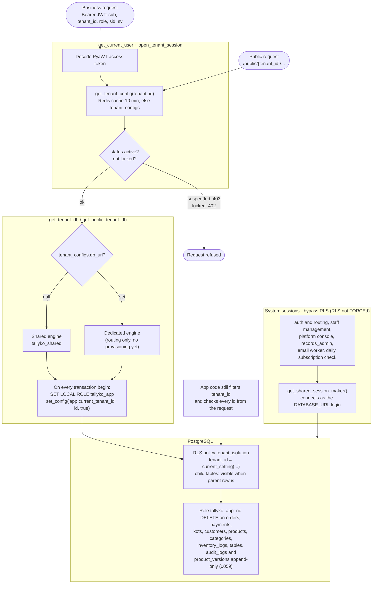

# Multi-Vendor Architecture

## 1. Overview

Most POS systems are one installation per business. Tallyko is a **multi-tenant SaaS**: one server serves many independent businesses (tenants), keeps their data strictly apart, and is updated once for everyone. The design also allows a tenant to live in its own database.

## 2. Core concepts

- **Platform (global) tables** hold data that is not owned by one business: `global_vendors` (the business; its `id` is the `tenant_id`), `tenant_configs` (status, plan, overrides, `paid_until`, `session_version`, optional `db_url`), `global_users` (logins), `user_sessions` (devices), plans and subscriptions, and console data. They have no RLS and are read through **system sessions**.
- **Business (tenant) tables** hold everything a shop owns: menu, orders, customers, staff, settings… Each has a `tenant_id` column (or follows a parent row that has one) and a Postgres **Row-Level Security** policy.
- **Shared database (default):** every tenant lives in one database (`tallyko_shared` in development, `POSTGRES_DB` in production).
- **Dedicated database (routing only):** if `tenant_configs.db_url` is set, that tenant's sessions use a separate engine. **There is no provisioning or per-tenant migration loop yet** (known gap), so no tenant uses this today.

See the tables in [04_Data_Model.md](./04_Data_Model.md).

## 3. How a request gets a tenant session

1. The client sends a JWT whose `tenant_id`, `role`, `staff_id`, `sid` (session id) and `sv` (session version) were set at login.
2. `get_current_user` loads the tenant config (Redis cache, 10 minutes; `drop_tenant_cache()` after any change) and refuses signed-out tokens (401) and locked subscriptions (402).
3. `get_tenant_db` (or `get_public_tenant_db` for public routes, using the `tenant_id` in the path) refuses suspended businesses (403), picks the shared or dedicated engine, and at the start of **every transaction** runs:
   ```sql
   SET LOCAL ROLE tallyko_app;
   SELECT set_config('app.current_tenant_id', '<tenant id>', true);
   ```
4. RLS policies (`tenant_isolation`) only show rows of that tenant. Child tables (`order_items`, `payments`, `product_variants`, `tax_class_rates`) are visible when their parent row is.
5. Application code still filters by `tenant_id` and checks that every id from the request (product, table, customer, order…) belongs to the tenant, because foreign-key checks bypass RLS.

<!-- diagram: 20_tenant_isolation drawio=Tallyko_Access_And_Sessions -->


*Diagram source: [`20_tenant_isolation.mmd`](diagrams/mermaid/20_tenant_isolation.mmd) · [SVG](diagrams/rendered/20_tenant_isolation.svg) · draw.io: [`Tallyko_Access_And_Sessions.drawio`](diagrams/Tallyko_Access_And_Sessions.drawio)*
<!-- /diagram -->

## 4. What the database role enforces

`tallyko_app` is a non-superuser role created by the RLS migrations (`backend/app/db/rls.py`):

- RLS applies to it on every tenant table.
- Migration `0059` removes DELETE on `orders`, `payments`, `kots`, `customers`, `products`, `product_categories`, `inventory_logs` and `tables`, and makes `audit_logs` and `product_versions` append-only (no UPDATE or DELETE). A business can never erase its records; see [019](./features/019_Owner_Watch_No_Deletes_And_Menu_History.md).
- RLS is **not FORCEd**, so system sessions (`get_shared_session_maker()`, connecting as the `DATABASE_URL` login) bypass it. They are used only for auth and routing, staff management, the platform console, `records_admin`, the email worker and the daily subscription check.

New tenant tables are marked `TENANT_RLS` or `child_rls(...)` in the model; the generated migration then adds the GRANTs and policy automatically ([19](./19_Database_Migrations.md)).

## 5. Onboarding

- **Self sign-up:** `POST /auth/register` creates the global user, `global_vendors` + `tenant_configs`, business settings, the default location, roles, sales channels and tax classes, and starts the free demo. Instant.
- **Onboarded by Tallyko:** the super admin creates the business in the console; the owner gets a temporary password.
- **Dedicated database (future):** provision a Postgres instance, run migrations against it, set `tenant_configs.db_url`, call `drop_tenant_cache()`. The migration loop over dedicated databases is not written yet.

## 6. Tests

`backend/tests/integration/test_tenant_isolation.py` calls every route in `PROTECTED_ROUTES` with a token from tenant B against tenant A's ids and expects nothing to leak. Add new protected routes to that list.
