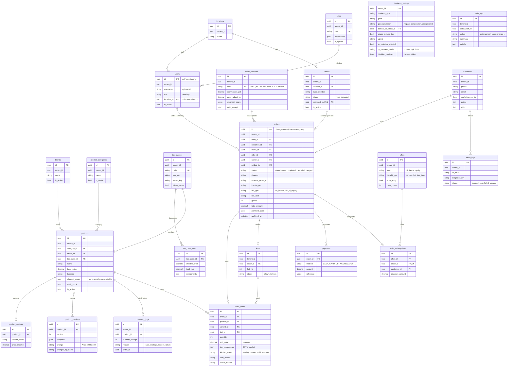

# Data Model & Schema Strategy

## 1. Schema philosophy

- Strict relational tables for the money path (orders, lines, payments, stock), with `JSON` columns where a business needs flexibility (channel prices, offer scopes, plan features, tax components, snapshots).
- **Snapshots, not references, for anything that must not change later:** each bill line stores its name, price and GST components; each subscription stores the plan it sold; each menu change stores a full product snapshot.
- **Nothing is deleted by a business.** Status columns and `is_active` flags replace deletes; the database role enforces it ([019](./features/019_Owner_Watch_No_Deletes_And_Menu_History.md)).
- **Ledgers instead of counters** where devices sync: stock on hand is the sum of `inventory_logs.quantity_change`.
- Models live in `backend/app/models/<area>.py` (accounts, business, catalog, sales, inventory, access, marketing, platform, tax). There are 38 tables; migrations are one per table ([19](./19_Database_Migrations.md)).

## 2. Platform (global) tables

No `tenant_id`, no RLS; read through system sessions.

| Group | Tables |
|---|---|
| Businesses and logins | `global_vendors`, `tenant_configs` (status, `plan_key`, feature/limit overrides, `paid_until`, `session_version`, `lapsed_at`, `db_url`), `global_users` (`platform_role`), `user_sessions` |
| Plans and subscriptions | `plans` (features, limits, `billing_options`), `subscriptions` (immutable snapshot), `subscription_offers`, `subscription_requests` |
| Platform admin | `platform_settings`, `platform_audit_logs`, `owner_requests`, `tax_presets`, `tax_preset_rates` (GST library) |

```mermaid
erDiagram
    global_vendors {
        uuid id PK "tenant_id everywhere"
        string name
        string business_type "restaurant, retail, cloud_kitchen, cafe"
        string plan_type "legacy"
        datetime created_at
    }
    tenant_configs {
        uuid vendor_id PK, FK
        string db_url "null = shared DB"
        string status "active, suspended, deleted"
        string plan_key FK
        json feature_overrides
        json limit_overrides
        datetime paid_until
        int session_version "bump = sign out every device"
        datetime lapsed_at
    }
    global_users {
        uuid id PK
        string email UK
        string phone UK
        string password_hash "bcrypt"
        bool is_active
        string platform_role "super_admin, support, null"
    }
    user_sessions {
        uuid id PK "sid in tokens"
        uuid user_id FK
        uuid tenant_id "null for platform logins"
        uuid staff_id
        string kind "business, platform"
        string device
        datetime last_seen_at
        datetime revoked_at
        string revoked_reason
    }
    plans {
        string key PK "basic, standard, pro"
        string name
        decimal price_monthly
        json features "module keys"
        json limits "max_staff, max_products, max_locations"
        json billing_options "months, price, label"
        bool is_active
    }
    subscriptions {
        uuid id PK
        uuid vendor_id FK
        json snap_entitlements "immutable: kind, plan, features, limits, price, offer, amount, recorded_by"
        datetime start_date
        datetime end_date
    }
    subscription_offers {
        uuid id PK
        string code UK
        string discount_type "percent, flat, none"
        decimal discount_value
        int extra_days
        json plan_keys
        int min_months
        int max_redemptions
        bool new_businesses_only
        bool show_to_owners
    }
    subscription_requests {
        uuid id PK
        uuid vendor_id FK
        string plan_key FK
        int months
        string offer_code
        decimal amount
        string method "UPI, bank"
        string reference
        string status "pending, approved, rejected"
        string reviewed_by
    }
    owner_requests {
        uuid id PK
        uuid vendor_id FK
        string kind "archive_bills, delete_bills, other"
        json order_ids
        string status "pending, done, rejected"
        string action_taken "archived, deleted, none"
        string response
    }
    platform_settings {
        string key PK "demo days, grace_days, payment details, job summary"
        json value
    }
    platform_audit_logs {
        uuid id PK
        string actor_email
        string action
        uuid target_tenant_id
        json details "incl. snapshots of deleted bills"
    }
    tax_presets {
        string key PK
        string name
        string hsn_sac
    }
    tax_preset_rates {
        uuid id PK
        string preset_key FK
        datetime effective_from
        decimal total_rate
        json components "CGST, SGST rates"
        string note "notification no."
    }

    global_vendors ||--|| tenant_configs : "routing and status"
    global_vendors ||--o{ subscriptions : "periods"
    global_vendors ||--o{ subscription_requests : "renewal claims"
    global_vendors ||--o{ owner_requests : "ask Tallyko"
    plans ||--o{ tenant_configs : "plan_key"
    plans ||--o{ subscription_requests : "plan_key"
    global_users ||--o{ user_sessions : "signed-in devices"
    tax_presets ||--o{ tax_preset_rates : "dated versions"
```

<!-- diagram: 16_erd_platform drawio=Tallyko_Database_ERD -->

*Diagram source: [`16_erd_platform.mmd`](diagrams/mermaid/16_erd_platform.mmd) · [SVG](diagrams/rendered/16_erd_platform.svg) · draw.io: [`Tallyko_Database_ERD.drawio`](diagrams/Tallyko_Database_ERD.drawio)*
<!-- /diagram -->

## 3. Business (tenant) tables

Each has `tenant_id` + RLS (`TENANT_RLS`), or follows its parent row (`child_rls`: `product_variants`, `order_items`, `payments`, `tax_class_rates`).

| Group | Tables |
|---|---|
| Setup and staff | `locations`, `users` (staff memberships, role key), `business_settings`, `tenant_counters`, `brands`, `sales_channels`, `roles`, `audit_logs` |
| Menu and tax | `product_categories`, `products` (`channel_prices`, `tax_class_id`), `product_variants`, `product_versions`, `tax_classes`, `tax_class_rates` |
| Floor and orders | `tables`, `orders` (`bill_label`, `guests`, `archived_at`, `payment_claim`, offer, `waiter_id`, `settled_by`), `order_items` (`kitchen_status`, void, comp, GST snapshot), `kots`, `payments` |
| Customers and marketing | `customers`, `offers`, `offer_redemptions`, `email_templates`, `email_logs`, `inventory_logs` |

<!-- diagram: 17_erd_business drawio=Tallyko_Database_ERD -->

*Diagram source: [`17_erd_business.mmd`](diagrams/mermaid/17_erd_business.mmd) · [SVG](diagrams/rendered/17_erd_business.svg) · draw.io: [`Tallyko_Database_ERD.drawio`](diagrams/Tallyko_Database_ERD.drawio)*
<!-- /diagram -->

### Status values worth knowing

| Column | Values |
|---|---|
| `orders.status` | `placed` (online, awaiting acceptance) → `open` → `completed` / `cancelled` / `merged`; `archived_at` is a separate flag set only by Tallyko |
| `orders.payment_status` | `unpaid`, `partial`, `paid` |
| `orders.bill_type` | `tax_invoice` or `bill_of_supply` (no valid GSTIN, composition, unregistered) |
| `order_items.kitchen_status` | null (not a kitchen item), `pending` → `preparing` → `ready` → `served`; `void` (cancelled after the kitchen had it), `removed` (taken off before) |
| `kots.status` | follows its lines; `cancelled` when every line is void |
| `tenant_configs.status` | `active`, `suspended`, `deleted` |

Lifecycles: [06_order_lifecycle](./diagrams/mermaid/06_order_lifecycle.mmd), [07_kitchen_item_status](./diagrams/mermaid/07_kitchen_item_status.mmd), [10_subscription_lifecycle](./diagrams/mermaid/10_subscription_lifecycle.mmd).

## 4. Immutable entitlements

When Tallyko records a subscription period, the plan's features, limits and price, the period kind (`trial`, `paid`, `complimentary`, `development`), any offer, the amount and who recorded it are copied into `subscriptions.snap_entitlements`. Editing a plan later never changes what a business already bought. `tenant_configs.paid_until` is recomputed from these periods; a new period continues from the current end date.

## 5. Ids and sync

- Every primary key is a UUID. The POS generates order ids on the device, so an offline bill keeps its id and `/sync/push` can treat it as an idempotency key.
- `orders.code` is a short code derived from the id (printed as the bill barcode, works offline); `invoice_no` is assigned per financial year on completion by `tenant_counters`.
- Tables that devices cache carry `updated_at`, which drives `POST /sync/pull {since}`.
