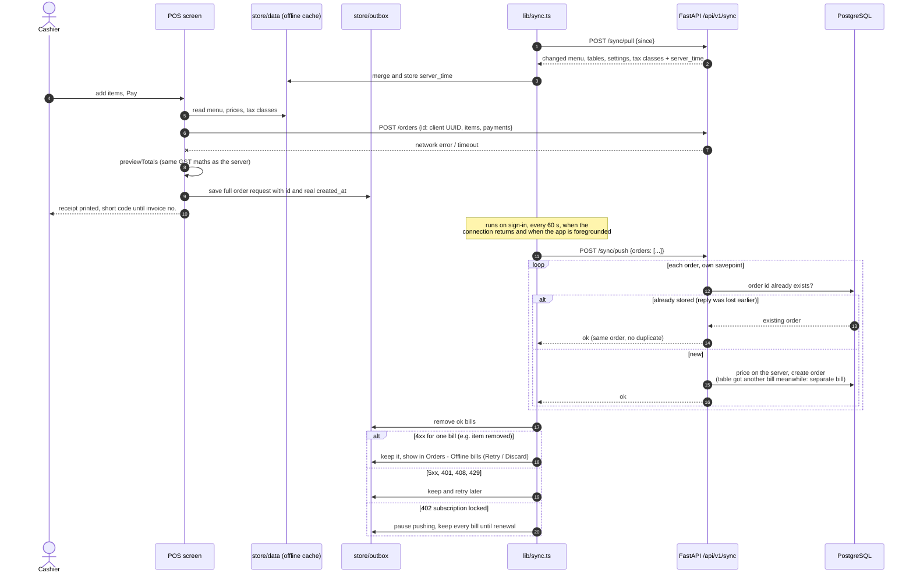

# App Architecture (web, Android, iOS)

## 1. One codebase

`frontend/` is a single **Expo SDK 57** app (React Native 0.86, React 19, TypeScript strict, **expo-router**, **zustand**). It ships as:

- **Web / PWA** for laptop and desktop browsers (installable, service worker caches the app shell, never `/api`);
- **Android** APK/AAB, built in Docker (`frontend/android.Dockerfile`) or with EAS;
- **iOS** via EAS / App Store, or the web app added to the home screen.

There is no separate owner dashboard: owner, manager, cashier, waiter and kitchen screens, the super admin console (`/admin`) and the public store pages are all routes in this app. Navigation is filtered by role, plan modules and business type (`src/components/nav/AppNav`: sidebar on ≥768 dp, bottom bar + "More" on phones). Every screen follows [20_High_Volume_UX.md](./20_High_Volume_UX.md).

## 2. Structure

```text
frontend/src
  app/                expo-router routes: (auth)/login|signup, (app)/pos|orders|tables|online|kitchen|menu/*|inventory|
                      customers|offers|reports|settings/*|watch|more, admin/*, store/[tenantId], subscription,
                      privacy, delete-account
  features/<area>/    screens and local state: pos, ops (tables, kitchen, online), catalog, settings, customers,
                      offers, reports, owner, subscription, admin, public, auth
  components/ui/      design system (Text, Button, Input, DataList, ActionMenu, SelectionBar, StatusPill, …)
  components/nav/     AppNav
  theme/              tokens (teal brand, slate neutrals, light/dark), ThemeProvider (useTheme, useLayout)
  api/                client (timeouts, refresh on 401, lock on 402, ApiError.network), typed endpoints
  store/              auth (SecureStore), access (/access/me), data (offline cache), outbox (offline bills),
                      prefs (printer, paper, theme, server URL), subscription, badges
  lib/                billing.ts (price preview = server maths), sync.ts, print/ (ESC/POS, layouts, printers),
                      barcode/ (Code128, EAN-13, QR), gstin.ts, tax.ts, format.ts
```

`frontend/android` and `frontend/ios` are generated by Expo CNG and not edited by hand. Store-compliance settings live in `app.json` ([18](./18_App_Store_And_Play_Compliance.md)).

## 3. Data flow and offline

There is **no local database** (no SQLite or WatermelonDB). Instead:

- **Selling screens read from `store/data`**: an offline cache (AsyncStorage / browser storage) of settings, menu, variants, tables, channels, brands, tax classes and recent customers, refreshed by `POST /sync/pull`.
- **Management screens call the API directly** and show loading / empty / error states.
- **Bills made offline go to `store/outbox`** with a client-generated UUID, and `lib/sync.ts` replays them through `POST /sync/push`. The receipt is printed from `lib/billing.ts#previewTotals`, which mirrors the server's GST maths (including "GST only with a valid GSTIN").
- On **401** the client refreshes the token once, then signs out. On **402** the app shows the renewal screen and pauses pushing; the outbox is kept.
- Kitchen display and Online orders **poll every 5 s**; there are no WebSockets.

<!-- diagram: 08_offline_sync -->


*Diagram source: [`08_offline_sync.mmd`](diagrams/mermaid/08_offline_sync.mmd) · [SVG](diagrams/rendered/08_offline_sync.svg)*
<!-- /diagram -->

Details: [07_Offline_Sync_Strategy.md](./07_Offline_Sync_Strategy.md).

## 4. Hardware

- **Printers:** ESC/POS bytes are built on the device (`lib/print/escpos.ts`) and sent over Bluetooth Classic (Android), BLE (Android/iOS), Web Bluetooth (Chrome/Edge), or the system print dialog (AirPrint, USB, network printers). See [Printing.md](./features/Printing.md).
- **Barcodes:** `expo-camera` scanning and keyboard-wedge USB/Bluetooth scanners (fast keystrokes ending in Enter). Codes are generated on the device (Code128, EAN-13, QR incl. UPI QR on bills).
- **Secure storage:** tokens in `expo-secure-store` (Keychain/Keystore); `localStorage` on the web.

## 5. Builds

| Target | How |
|---|---|
| Web dev | `docker compose up --watch` → http://localhost:8081 |
| Web production | `docker compose --profile preview up -d --build` (:8080) or the `web` service in `docker-compose.prod.yml` (Caddy) |
| Android | `docker compose --profile android run --rm android-build` → `dist/tallyko-<version>.apk` + `.aab` (signed, 16 KB alignment checked) |
| iOS | EAS (`eas.json`, needs an Apple account) or the home-screen web app |
