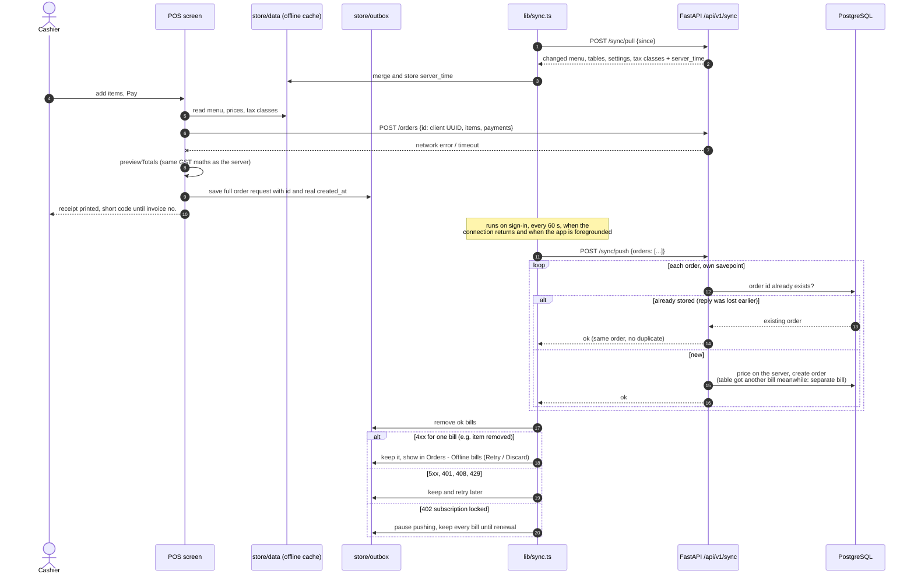

# Offline Sync Strategy

## Goal

A shop must never stop billing because the internet dropped. Tallyko's rule: **the counter keeps selling offline, and every bill reaches the server exactly once** when the connection returns.

## How it works (v2.0.0)

1. **Local cache** — `frontend/src/store/data.ts` keeps the business settings, menu (categories, products, variants), tables, channels, brands, tax classes and recent customers on the device (AsyncStorage / browser storage). The POS reads only from this cache, so it opens and works instantly offline.
2. **Pull** — `POST /api/v1/sync/pull {since}` returns everything changed since the last `server_time` (rows carry `updated_at`; deleted products come back with `is_active: false`). First sync, or a different business on the same device, gets a full snapshot. The device replaces/merges and stores the new `server_time`.
3. **Bills offline** — when creating an order fails with a network error, the POS saves the full order request in the **outbox** (`frontend/src/store/outbox.ts`) with a **client-generated UUID** and the real `created_at`, prints the receipt from the locally computed totals (`lib/billing.ts#previewTotals`, the same GST maths as the server) and moves on. The bill shows its short code (also the barcode) until the server assigns the invoice number.
4. **Push** — `POST /api/v1/sync/push {orders: [...]}` replays queued orders. Each one runs in its own savepoint, so one bad bill can't block the others. The order `id` is an **idempotency key**: if the request already reached the server (e.g. the connection died before the reply), the server returns the existing order instead of creating a duplicate. Results per order: `ok` (removed from the outbox) or `error` with a code — 4xx means "needs a human" (e.g. an item was deleted meanwhile) and is shown in Orders → Offline bills with Retry/Discard; 5xx, 401, 408 and 429 are retried automatically. A bill for a table that got another bill meanwhile becomes a separate bill on that table; it is never lost.
5. **Subscription locked (402)** — pushing pauses and every queued bill stays on the device until the owner renews; then the outbox drains as usual. Nothing is deleted.
6. **When it runs** — on sign-in, every 60 s, when connectivity returns (NetInfo), and when the app comes to the foreground (`frontend/src/lib/sync.ts`). A banner shows "offline · N bills waiting" and failures.

## Sequence

<!-- diagram: 08_offline_sync -->

*Diagram source: [`08_offline_sync.mmd`](diagrams/mermaid/08_offline_sync.mmd) · [SVG](diagrams/rendered/08_offline_sync.svg)*
<!-- /diagram -->

## What needs the server

Running tables (open orders shared between devices), accepting online/aggregator orders, reports and menu editing need a connection. Offers are evaluated online only: a bill made offline syncs without an offer. A shop that wants these to keep working during internet outages runs the server on a PC in the shop (see `docs/17_Free_Cloud_Deployment.md`, Option A) — then "offline" only means the shop PC is off.

## Conflict rules

- Bills are append-only; there is nothing to merge — the idempotency key settles duplicates.
- Stock is a ledger (`inventory_logs`), so offline sales apply as differences, never overwrite totals.
- Menu/settings changes are made online and flow down via pull (last write wins on the server).
- Offline `created_at` is kept for reports but clamped to "not in the future and not older than 30 days".

## Tests

`backend/tests/integration/test_sync.py` — full + incremental pull, deleted items, idempotent push, partial failure isolation, missing client ids.
