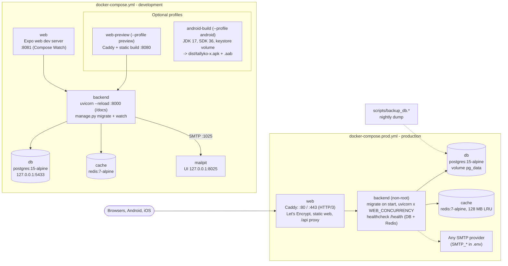

# Docker & Deployment

## 1. Rules

- **Everything runs in Docker Compose**: development, the production-build preview, Android builds and production. There are no "install locally" steps for services.
- Only free and open-source software: Postgres, Redis, Caddy, Mailpit, RapidOCR. No managed databases, no paid build services.

## 2. Compose files

| File / profile | Services | Use |
|---|---|---|
| `docker-compose.yml` (project `tallyko`) | `db`, `cache`, `backend`, `mailpit`, `web` | Development with live reload |
| `--profile preview` | `web-preview` | The production web build behind Caddy on :8080 |
| `--profile android` | `android-build` | Signed APK + AAB into `dist/` |
| `docker-compose.prod.yml` (project `tallyko-prod`) | `db`, `cache`, `backend`, `web` | Production on one server |

<!-- diagram: 18_deployment drawio=Tallyko_Docker_Deployment -->


*Diagram source: [`18_deployment.mmd`](diagrams/mermaid/18_deployment.mmd) · [SVG](diagrams/rendered/18_deployment.svg) · draw.io: [`Tallyko_Docker_Deployment.drawio`](diagrams/Tallyko_Docker_Deployment.drawio)*
<!-- /diagram -->

### Development (`docker-compose.yml`)

| Service | Image / build | Ports | Notes |
|---|---|---|---|
| `db` | `postgres:15-alpine` | `127.0.0.1:5433` | volume `pg_data`, database `tallyko_shared` |
| `cache` | `redis:7-alpine` | (internal) | volume `redis_data` |
| `backend` | `backend/Dockerfile` target `dev` | `8000` | bind-mounts `./backend`, `uvicorn --reload` with polling, runs `manage.py migrate` then `watch`; healthcheck `/health` |
| `mailpit` | `axllent/mailpit` | `127.0.0.1:8025` | every dev email lands here (SMTP :1025 inside the network) |
| `web` | `frontend/Dockerfile` target `dev` | `8081` | Expo web dev server; `docker compose up --watch` syncs edits |
| `web-preview` | `frontend/Dockerfile` target `prod` | `8080` | Caddy + static build, proxies `/api` to `backend` |
| `android-build` | `frontend/android.Dockerfile` | — | JDK 17 + Android SDK 36, volumes `android_gradle`, `android_keystore`, 16 KB alignment check |

### Production (`docker-compose.prod.yml`)

| Service | Notes |
|---|---|
| `db` | `postgres:15-alpine`, volume `pg_data`, database/user from `POSTGRES_DB` / `POSTGRES_USER` (default `tallyko`) |
| `cache` | `redis:7-alpine`, 128 MB with LRU eviction, volume `redis_data` |
| `backend` | target `prod`: non-root user, runs `manage.py migrate` on start, uvicorn with `WEB_CONCURRENCY` workers (default 2), `TRUST_PROXY=true`, healthcheck `/health`, logs to volume `api_logs`. Refuses to start with the default `JWT_SECRET` or database password. |
| `web` | Caddy: ports 80, 443 and 443/udp (HTTP/3), `SITE_ADDRESS=${DOMAIN}`, automatic Let's Encrypt certificates (volumes `caddy_data`, `caddy_config`), serves the web build and proxies `/api` to `backend:8000` |

The email worker and the 01:00 IST subscription scheduler run **inside** the backend container (asyncio tasks in the API lifespan); there is no separate worker container or message broker.

> **SMTP in production:** set `SMTP_*` in `.env`. `docker-compose.prod.yml` passes them, and `PUBLIC_APP_URL`, which defaults to `https://$DOMAIN`, to `backend`. Without `SMTP_HOST`, emails are logged as `skipped`.

## 3. Configuration

Production reads `.env` next to the compose file (`cp .env.example .env`): `DOMAIN`, `ACME_EMAIL`, `JWT_SECRET` (required), `POSTGRES_PASSWORD`, `POSTGRES_USER`, `POSTGRES_DB`, `CORS_ORIGINS`, `TIMEZONE`, `WEB_CONCURRENCY`, `APK_API_URL`, `APP_VERSION_CODE`. `scripts/setup.*` fills random secrets. More in [12_Environments_And_Config.md](./12_Environments_And_Config.md).

## 4. Deploying and updating

```bash
docker compose -f docker-compose.prod.yml up -d --build      # first deploy and every update
docker compose -f docker-compose.prod.yml logs -f backend
scripts/backup_db.sh   # or .ps1; restore with scripts/restore_db.sh
```

Migrations run on start and are forward-only, so the previous app version keeps working against the new schema. Step-by-step guides for a shop PC or a free cloud VM: [17_Free_Cloud_Deployment.md](./17_Free_Cloud_Deployment.md).

## 5. Dedicated tenant databases

Routing supports a per-tenant `tenant_configs.db_url`, but there is **no provisioning or per-tenant migration loop yet** (known gap). Nothing in the compose files creates extra databases.
