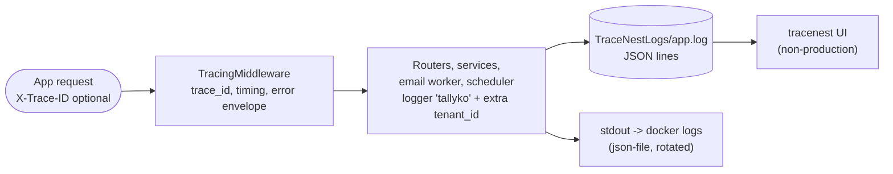

# Logging & Observability

## 1. Tracenest mandate

Every backend log goes through `logging.getLogger("tallyko")` and is formatted as structured JSON by [`tracenest`](https://pypi.org/project/tracenest/). `print()` is not allowed in app code. Messages start with a `[Domain]` prefix (`[Billing]`, `[Auth]`, `[Email]`, `[Subscriptions]`, `[Integrations]`…) and pass the tenant: `logger.info("[Billing] …", extra={"tenant_id": tenant_id})`.

## 2. What exists

### Request tracing (`app/main.py`, `TracingMiddleware`)
- Takes `X-Trace-ID` from the request (the app may send one) or generates a UUID, stores it on `request.state`, and returns it in the `X-Trace-ID` response header.
- Logs one line per request (method, path, status, duration), except `/health`.
- Unhandled exceptions are logged with the stack trace at `ERROR` and answered with the standard envelope `{"success": false, "error": {"code": "INTERNAL_SERVER_ERROR", "message": …, "trace_id": …}}`, so no stack trace reaches the client.
- Adds basic security headers (`X-Content-Type-Options`, `X-Frame-Options`, `Referrer-Policy`); Caddy adds HSTS in production.

### Background tasks
The email worker and the subscription scheduler run in the API process and log through the same logger (`[Email]`, `[Subscriptions]`), with `tenant_id` where one applies. There are no Celery/ARQ workers to propagate context to.

### Where logs land
| Where | What |
|---|---|
| `backend/TraceNestLogs/app.log` (dev bind mount) / volume `api_logs` (prod) | tracenest JSON lines (`LOG_DIR` overrides the folder) |
| `docker compose logs backend` | uvicorn and Python logging on stdout; prod uses the `json-file` driver with rotation (10 MB × 5) |
| tracenest UI router | mounted in non-production environments for browsing logs |

To follow one request, copy `X-Trace-ID` from the response (or from the error shown in the app) and search for it:

```bash
docker compose logs backend | grep <trace id>
grep <trace id> backend/TraceNestLogs/app.log
```

## 3. Flow



## 4. Not built

No log shipping or dashboards exist: no Promtail/Fluent Bit, Grafana Loki, Grafana, metrics or alerting. If they are added later, they must be free and self-hosted, and can read the JSON file or the Docker logs above. Until then, `docker compose logs`, `app.log` and `GET /health` are the tools.
