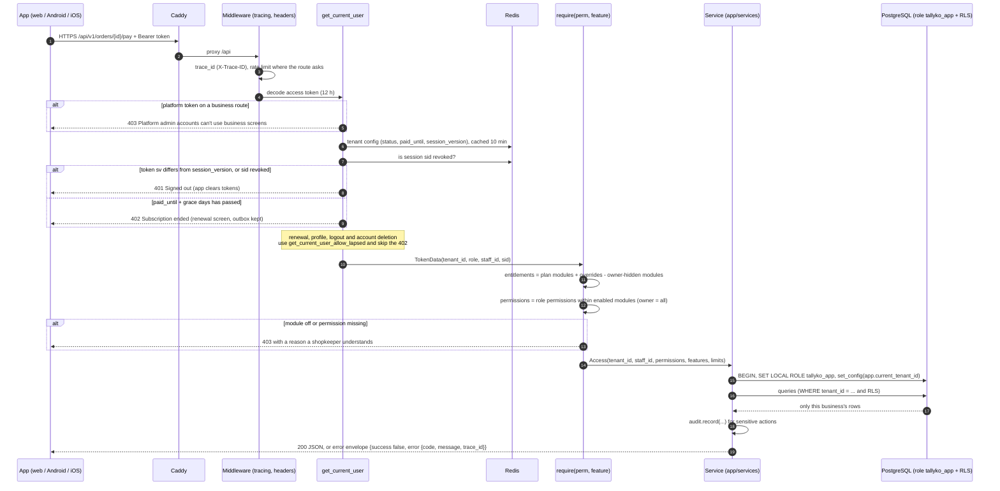
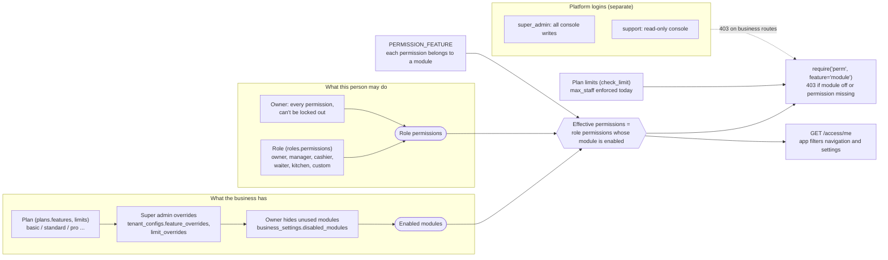

# Security & Authentication

## 1. Tenant isolation (no cross-talk)

One business must never see another's data. Tallyko enforces this in two layers:

1. **Application:** every tenant query filters `tenant_id`, and every id from a request (product, table, customer, order, brand…) is checked to belong to the caller's business, because foreign-key checks bypass RLS.
2. **Database:** tenant sessions run as role `tallyko_app` with `app.current_tenant_id` set per transaction; Postgres **Row-Level Security** hides other tenants' rows even if a query forgets the filter.

Details and diagram: [03_Multi_Vendor_Architecture.md](./03_Multi_Vendor_Architecture.md). The isolation test calls every protected route with another tenant's token (`tests/integration/test_tenant_isolation.py`).

## 2. Logins, tokens and sessions

- **Passwords:** bcrypt. Login by email or phone (`POST /auth/login`). `python-jose`/`passlib` were replaced by **PyJWT** and `bcrypt`.
- **Every sign-in is a device session** (`user_sessions`: device from User-Agent, IP, last seen, revoked).
- **Access token** (12 h, one shop shift): `sub`, `tenant_id`, `role`, `staff_id`, `sid` (session id), `sv` (the business's `session_version`). **Refresh token** (30 days) carries `sid` and `sv` too; refreshing a revoked session is refused.
- **Platform logins** (`super_admin`, `support`) get tokens with `platform_role` and no tenant. They get 403 on business routes; business tokens get 403 on `/platform`.
- Tokens are stored with `expo-secure-store` (Keychain/Keystore) on devices and `localStorage` on the web. The API client refreshes once on 401, then signs out.
- `JWT_SECRET` must be random and ≥32 characters; the API refuses to start in production otherwise (or with the default database password).

### Signing devices out

| Action | Mechanism |
|---|---|
| Sign out one device (user or super admin) | Session marked revoked + `session:revoked:{sid}` in Redis → 401 on the next request |
| Sign out a whole business (super admin, daily subscription check) | All sessions revoked + `tenant_configs.session_version` bumped → every token's `sv` is stale → 401 |
| Password change | Every other session of that login revoked |
| Staff deactivated, role changed, password reset | That person's sessions revoked |

The single-device check reads Redis and fails open if Redis is down; the business-wide `session_version` check always applies (known gap 4).

## 3. Request checks in order

<!-- diagram: 03_request_pipeline drawio=Tallyko_Access_And_Sessions -->

*Diagram source: [`03_request_pipeline.mmd`](diagrams/mermaid/03_request_pipeline.mmd) · [SVG](diagrams/rendered/03_request_pipeline.svg) · draw.io: [`Tallyko_Access_And_Sessions.drawio`](diagrams/Tallyko_Access_And_Sessions.drawio)*
<!-- /diagram -->

- **402 subscription lock:** when `paid_until` + grace days has passed, every business route answers 402 and the app shows the renewal screen. Routes a locked business must still reach use `get_current_user_allow_lapsed`: renewal (`/subscription`), profile, logout and account deletion. Public store/QR ordering also stops. See [018](./features/018_Subscriptions_Demo_And_Sessions.md).
- **Suspended** businesses (super admin) get 403 at the database-session level.

## 4. Roles, permissions and plan modules

Access is decided by what the business has (plan modules + super admin overrides − modules the owner hid) **and** what the person's role may do (~30 permissions). Owners have every permission but still only the modules of their plan. Routes declare `Depends(require("perm.code", feature="module"))`; `GET /access/me` gives the app the same answer to filter navigation. Details: [013](./features/013_Staff_Roles_And_Access.md).

<!-- diagram: 04_access_model drawio=Tallyko_Access_And_Sessions -->

*Diagram source: [`04_access_model.mmd`](diagrams/mermaid/04_access_model.mmd) · [SVG](diagrams/rendered/04_access_model.svg) · draw.io: [`Tallyko_Access_And_Sessions.drawio`](diagrams/Tallyko_Access_And_Sessions.drawio)*
<!-- /diagram -->

## 5. Records can't be erased

The `tallyko_app` role has **no DELETE** on orders, payments, KOTs, customers, products, categories, stock movements and tables, and `audit_logs` / `product_versions` are append-only (migration `0059`). Cancel/remove are statuses; menu items, categories and tables are switched off. Only the Tallyko super admin can archive or hard-delete, through system sessions, with a snapshot in `platform_audit_logs`. Sensitive actions are written to `audit_logs` (`audit.record`); some are visible only on the owner's watch. See [019](./features/019_Owner_Watch_No_Deletes_And_Menu_History.md).

## 6. API hardening

- **Rate limits** (Redis sliding window, fail open): a whole shop shares one public IP, so limits are per account / per customer phone with high per-IP ceilings (login 20 per 15 min per account, 60/min per IP). `X-Forwarded-For` is trusted only with `TRUST_PROXY=true` (set in production behind Caddy). Full list in [05_API_Design.md](./05_API_Design.md).
- **Server prices everything:** clients send ids and quantities, never prices, totals or discounts the server didn't check.
- **Webhooks:** `X-Tallyko-Signature` = HMAC-SHA256 of the raw body with the channel secret, compared in constant time; 256 KB body limit; secrets rotate via the owner.
- **Errors:** one JSON envelope with a readable message and `trace_id`; no stack traces.
- **Uploads:** menu photos ≤10 MB, ≤64 MP, image types only; processed in memory, not stored.
- **Headers:** `X-Content-Type-Options`, `X-Frame-Options: DENY`, `Referrer-Policy`; Caddy adds HSTS.

## 7. Network

- **Production:** Caddy terminates TLS with Let's Encrypt and redirects HTTP to HTTPS. Postgres and Redis expose no ports; only Caddy's 80/443 are published.
- **Development:** Postgres is bound to `127.0.0.1:5433` and Mailpit to `127.0.0.1:8025`; the API (:8000) and web (:8081) are reachable on the LAN for testing phones.
- A shop running the server on a local PC may use plain HTTP inside the shop LAN only; Web Bluetooth and "Install app" need HTTPS ([17](./17_Free_Cloud_Deployment.md)).
