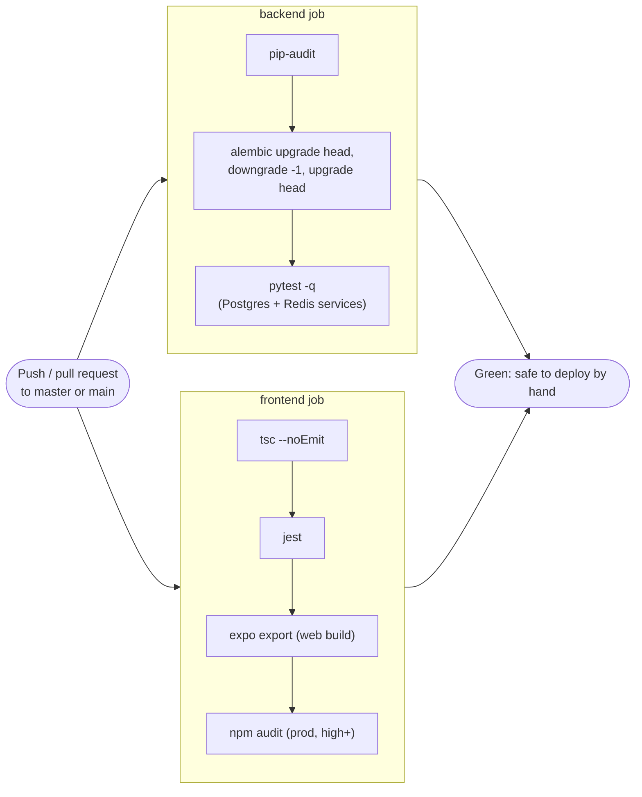

# CI/CD Pipeline

## 1. Philosophy

Competitors break shops with bad updates. Tallyko's defence is: every change is tested automatically, migrations are forward-only and tested both ways, the API keeps old `/api/v1` shapes, and the POS keeps billing offline if the server is briefly down.

## 2. What CI does today (`.github/workflows/ci.yml`)

Runs on GitHub Actions for every push and pull request to `master`/`main`.

| Job | Steps |
|---|---|
| `backend` (Python 3.11, Postgres 15 + Redis 7 service containers) | install OCR system libraries → `pip install -r requirements-dev.txt` → `pip-audit -r requirements.txt` → migrations **up, one down, up again** → `pytest` (unit + integration on a real database) |
| `frontend` (Node 22) | `npm ci` → `tsc --noEmit` → `jest` → `expo export --platform web` (the production web build) → `npm audit --omit=dev --audit-level=high` |



Locally, the same checks are:

```bash
docker compose exec backend python -m pytest -q
docker compose exec backend python manage.py db:check
cd frontend && npx tsc --noEmit && npx jest
```

## 3. Deployment (manual)

There is **no automated deployment, container registry, staging server or canary release**. A release is:

1. Bump `VERSION`, `frontend/app.json` `expo.version`, add `changelog/vX.Y.Z.md` and update `CHANGELOG.md`.
2. On the server: `git pull && docker compose -f docker-compose.prod.yml up -d --build`. The backend migrates on start; Caddy keeps serving.
3. Android: `docker compose --profile android run --rm android-build`, upload the AAB to Play (or share the APK). iOS: EAS build if an Apple account is set up.

Rollback: check out the previous tag and run the same `up -d --build`. This is safe because migrations within a release are non-destructive ([13](./13_Reliability_And_Rollback.md), [19](./19_Database_Migrations.md)).

## 4. Not built

Image builds in CI, a registry, staging, canary/weighted routing (the old plan used Traefik, which is not used), automatic rollback on error rates, and Fastlane/EAS in CI. Anything added must stay free.
