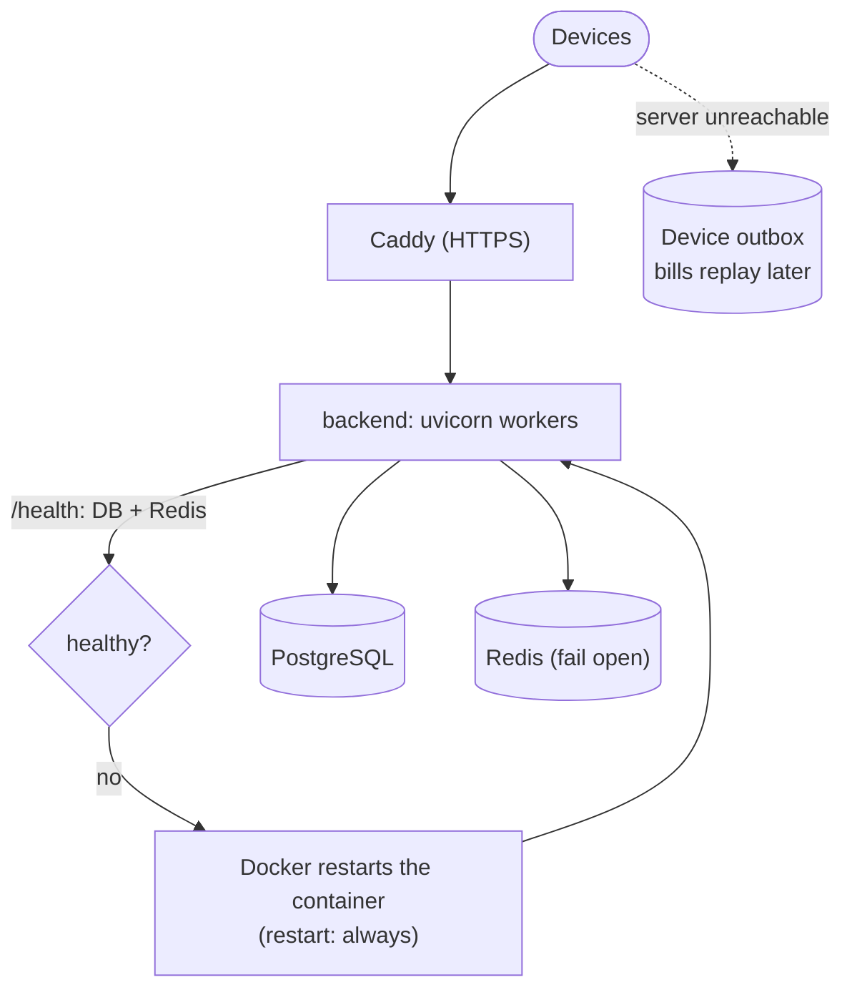

# Reliability & Rollback Strategy

## 1. The competitor weakness

Shopto reviews cite multi-day outages and features breaking after updates. Tallyko treats "the counter keeps billing" as a hard requirement.

## 2. Health checks and self-healing

- `GET /health` checks Postgres and Redis. The backend container's healthcheck calls it; `db` and `cache` have their own healthchecks, and `backend` starts only after both are healthy.
- Production services use `restart: always` (dev: `unless-stopped`), so Docker restarts a crashed container.
- One server runs uvicorn with `WEB_CONCURRENCY` workers; a crashed worker is replaced by uvicorn. There is no load balancer or replica pool (the old plan's Traefik routing is not used).

## 3. Graceful degradation

| Failure | What happens |
|---|---|
| Internet down at the shop | POS keeps billing from the offline cache; bills wait in the outbox and replay exactly once ([07](./07_Offline_Sync_Strategy.md)). A server on a shop PC keeps tables, kitchen and online orders working on the LAN ([17](./17_Free_Cloud_Deployment.md)). |
| Redis down | Rate limiting fails open; tenant config is read from Postgres; single-device revocation isn't checked (business-wide sign-out still is); the daily job runs without its lock (it is idempotent); "add to my bill" retries may duplicate rarely. |
| SMTP down / not configured | Emails stay `queued` and are retried (3 attempts), or are logged `skipped`; billing is unaffected. |
| OCR slow or failing | Only the menu-photo import shows an error; billing is unaffected. |
| Server down at 01:00 IST | The subscription check runs when the API starts again. |
| Subscription lapsed | Business screens show the renewal screen (402); data and offline bills are kept. |
| Heavy report query | Reports are separate endpoints; they don't block billing transactions. |

## 4. Rollback

1. **Code:** check out the previous release tag and run `docker compose -f docker-compose.prod.yml up -d --build`. Images are built on the server; there is no registry of old images yet.
2. **Database:** migrations are **forward-only and non-destructive within a release**: no column or table is dropped in the release that stops using it. The older code still finds every column it expects, so a code rollback needs no schema rollback. `manage.py rollback` exists for development; avoid it on production data.
3. **Data:** nightly `scripts/backup_db.*`; restore with `scripts/restore_db.sh`. Test a restore once before going live.
4. **Records:** businesses can't delete bills (database role), and Tallyko prefers archiving to deleting, so mistakes are reversible ([019](./features/019_Owner_Watch_No_Deletes_And_Menu_History.md)).

## 5. Flow

