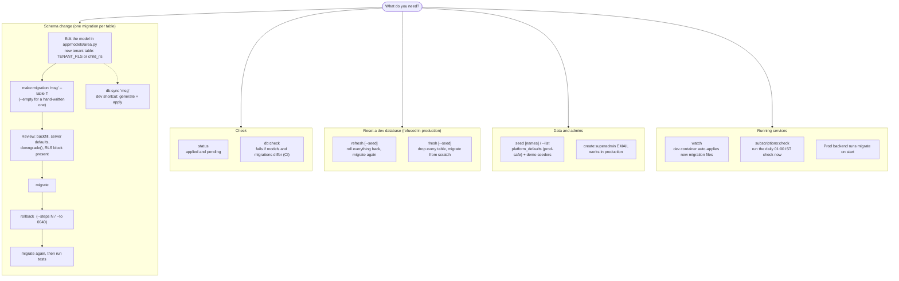

# 19 · Database Migrations & Seeders

All schema changes and seed data go through `backend/manage.py`, a Laravel-artisan-style CLI over Alembic. Run it inside the backend container. The dev container runs `migrate` on start and `watch` in the background, so new migration files apply as soon as they're saved.

```bash
docker compose exec backend python manage.py <command>
# or from the repo root:  ./scripts/db.sh <command>   (Windows: .\scripts\db.ps1 <command>)
```

| Command | What it does |
|---|---|
| `migrate [--to 0040]` | Apply pending migrations, or move up/down to a revision |
| `rollback [--steps N \| --to 0040]` | Undo the last N migrations (default 1) or back to a revision |
| `status` | Applied and pending migrations |
| `make:migration "msg" [--table T] [--empty]` | Autogenerate from model changes. `--table` keeps it to one table; `--empty` gives a blank file |
| `db:sync ["msg"]` | Dev: autogenerate from model changes **and** apply it. The "I altered a model, sync my DB" button |
| `db:check` | Fails if models and migrations differ (used in CI) |
| `refresh [--seed]` | Dev: roll everything back, migrate again, optionally seed |
| `fresh [--seed]` | Dev: drop every table, migrate from scratch, optionally seed |
| `seed [names…] [--list]` | Run all or selected seeders |
| `watch` | Dev: apply new or changed migration files automatically |
| `subscriptions:check` | Run the daily 01:00 IST subscription check now (idempotent) |
| `create:superadmin EMAIL [--name] [--role] [--password]` | Create or promote a platform admin (works in production) |

<!-- diagram: 19_migrations_cli -->


*Diagram source: [`19_migrations_cli.mmd`](diagrams/mermaid/19_migrations_cli.mmd) · [SVG](diagrams/rendered/19_migrations_cli.svg)*
<!-- /diagram -->

`refresh`, `fresh` and demo seeders refuse to run when `ENVIRONMENT=production` (`--force` overrides `refresh`/`fresh`; think twice).

## Layout

- `backend/app/models/<area>.py`: models grouped by area (accounts, business, catalog, sales, inventory, access, marketing, platform, tax), re-exported from `app/models/__init__.py`.
- `backend/alembic/versions/NNNN_<what>.py`:
  - **one migration per table** (`0002_create_global_vendors_table.py` … `0062_add_ops_thresholds_to_business_settings.py`);
  - ids are sequential and assigned automatically by `alembic/env.py`.
- `backend/app/db/rls.py`:
  - SQL for the `tallyko_app` role, GRANTs and `tenant_isolation` policies.
  - Models marked with `TENANT_RLS` / `child_rls(...)` get these added to their generated migration automatically.
- `backend/app/db/seeders/`:
  - one idempotent seeder class per file, registered in `SEEDERS`;
  - `platform_defaults` (plans and the GST library; production-safe);
  - `demo_platform_admins`, `demo_restaurant`, `demo_staff`, `demo_retail`, `demo_cloud_kitchen`, `demo_subscriptions` (dev only; demo logins in [15](./15_Developer_Onboarding.md)).

## Workflow for a schema change

1. Edit the model.
2. Run `make:migration "add notes to tables" --table tables`.
3. Review the file:
   - backfills;
   - server defaults;
   - `downgrade()`;
   - that the RLS block is there for new tenant tables.
4. Run `migrate`, then `rollback`, then `migrate` again.
5. Run the tests.

During a release, changes must be **non-destructive**: new columns are nullable or have defaults, and drops wait for a later release. See `docs/13_Reliability_And_Rollback.md`.

Databases created before v2.0.0 use the archived migration chain (`legacy/backend-v1/alembic_versions`). `manage.py` detects them and asks you to recreate them in dev (`fresh --seed`). Back up first with `scripts/backup_db.*` if the data matters.
