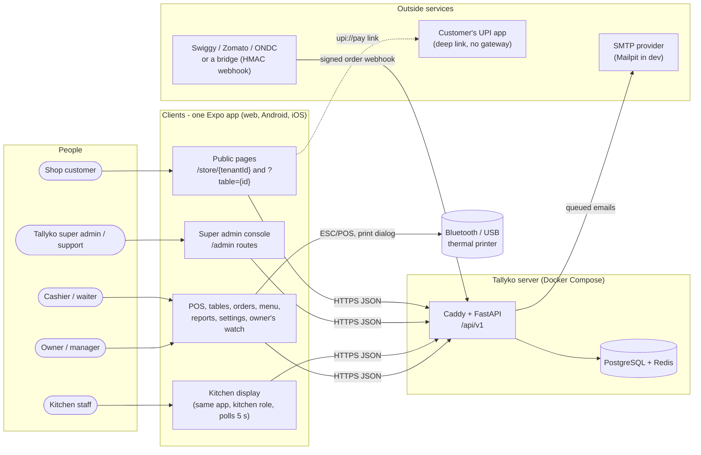
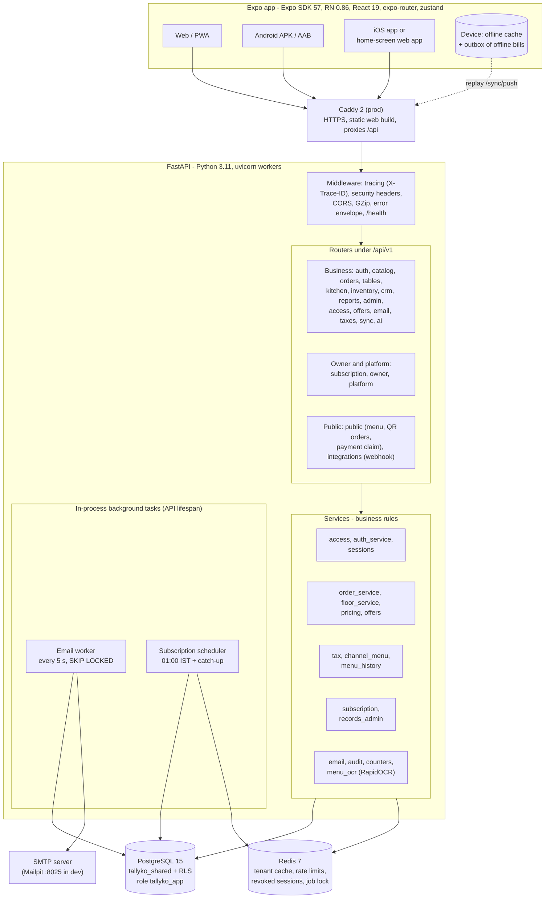
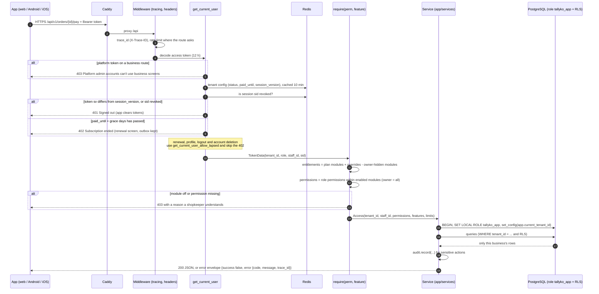

# Tallyko documentation

## What Tallyko is

Tallyko is a multi-tenant SaaS **point of sale** for Indian restaurants, cafés, cloud kitchens and retail shops: GST billing (only with a valid GSTIN), tables and running bills, a kitchen display, barcodes and stock, customers and loyalty, offers, QR table ordering with UPI, Swiggy/Zomato orders, reports, and an owner's watch over every cancellation and discount. Shopkeepers use **one Expo app** on a laptop browser (PWA), Android and iOS; billing keeps working offline. The server is FastAPI + PostgreSQL (Row-Level Security) + Redis behind Caddy, and everything runs in Docker Compose using only free, open-source software. These docs describe **v2.0.0** as built (October 2026); anything planned but not built is marked as such.

## Who should read what

| You are… | Start with | Then |
|---|---|---|
| **Owner / product** — what it does and why | [00 Product overview](./00_Product_Overview.md) | The "For the business owner" sections of the [feature specs](#part-2-feature-specifications), [14 Roadmap](./14_Roadmap_And_Chronology.md), [Versions](#versions) |
| **Developer** — changing code | [15 Developer onboarding](./15_Developer_Onboarding.md), [`CLAUDE.md`](../CLAUDE.md) | [02 Architecture](./02_System_Architecture.md), [03 Multi-tenancy](./03_Multi_Vendor_Architecture.md), [10 Security](./10_Security_And_Auth.md), [05 API](./05_API_Design.md), [19 Migrations](./19_Database_Migrations.md), [20 UX standard](./20_High_Volume_UX.md), then the spec for the area you touch |
| **Operator / deployer** — running a server | [17 Free deployment](./17_Free_Cloud_Deployment.md) | [08 Docker & deployment](./08_Docker_And_Deployment.md), [12 Environments](./12_Environments_And_Config.md), [13 Reliability & rollback](./13_Reliability_And_Rollback.md), [09 Logging](./09_Logging_And_Observability.md), [016 Super admin console](./features/016_Super_Admin_Console.md) |
| **Store reviewer / compliance** | [18 App Store & Play compliance](./18_App_Store_And_Play_Compliance.md) | [10 Security](./10_Security_And_Auth.md), account deletion in [001](./features/001_Auth_And_Tenant_Setup.md), [Printing](./features/Printing.md) (Bluetooth permissions) |

## How the docs are organised

- **Part 1 — Architecture and operations** (`docs/00`–`20`): how the system is built, run, secured, tested and deployed.
- **Part 2 — Feature specifications** (`docs/features/001`–`019`, `Printing.md`): one file per module, numbered in build order. Each has a plain-language part for the business owner and a technical part for developers (data, endpoints, rules, tests).
- **Diagrams** (`docs/diagrams/`): Mermaid sources (`.mmd`, embedded in the docs and rendered by GitHub) and draw.io overviews. See [diagrams/README.md](./diagrams/README.md).
- **Versions** (`docs/versions/`): what each release contained and what comes next.

When behaviour changes, the spec and its diagram change in the same commit.

## Suggested reading order

1. [00 Product overview](./00_Product_Overview.md) → [01 Tech stack](./01_Tech_Stack_And_Justification.md) → [02 System architecture](./02_System_Architecture.md)
2. [03 Multi-tenancy](./03_Multi_Vendor_Architecture.md) → [04 Data model](./04_Data_Model.md) → [10 Security & auth](./10_Security_And_Auth.md) → [05 API](./05_API_Design.md)
3. [06 App architecture](./06_Mobile_App_Architecture.md) → [07 Offline sync](./07_Offline_Sync_Strategy.md) → [20 High-volume UX](./20_High_Volume_UX.md)
4. [15 Onboarding](./15_Developer_Onboarding.md) → [19 Migrations](./19_Database_Migrations.md) → [08 Docker](./08_Docker_And_Deployment.md)
5. Feature specs [001](./features/001_Auth_And_Tenant_Setup.md) to [019](./features/019_Owner_Watch_No_Deletes_And_Menu_History.md) in order

## Part 1: Architecture and operations

| Doc | What it covers |
|---|---|
| [00_Product_Overview.md](./00_Product_Overview.md) | Vision, differentiators vs Shopto, target market |
| [01_Tech_Stack_And_Justification.md](./01_Tech_Stack_And_Justification.md) | Every technology and why; what was dropped (Traefik, Celery, MinIO, WatermelonDB) |
| [02_System_Architecture.md](./02_System_Architecture.md) | Clients, Caddy, FastAPI routers and services, background tasks, data stores |
| [03_Multi_Vendor_Architecture.md](./03_Multi_Vendor_Architecture.md) | Tenants, RLS sessions, the `tallyko_app` role, shared vs dedicated databases |
| [04_Data_Model.md](./04_Data_Model.md) | The 38 tables, ERDs, status values, snapshots, immutable subscriptions |
| [05_API_Design.md](./05_API_Design.md) | `/api/v1` conventions, error envelope, status codes, every router, rate limits |
| [06_Mobile_App_Architecture.md](./06_Mobile_App_Architecture.md) | One Expo app for web/Android/iOS: structure, offline cache, outbox, hardware, builds |
| [07_Offline_Sync_Strategy.md](./07_Offline_Sync_Strategy.md) | Pull, outbox, idempotent `/sync/push`, retries, 402 pause, conflict rules |
| [08_Design_System.md](./08_Design_System.md) | Colours, type, spacing and components of the app |
| [08_Docker_And_Deployment.md](./08_Docker_And_Deployment.md) | Compose files, services, ports, volumes, production setup |
| [09_Logging_And_Observability.md](./09_Logging_And_Observability.md) | tracenest JSON logs, trace ids, where logs land |
| [10_Security_And_Auth.md](./10_Security_And_Auth.md) | Tokens, device sessions, 401/402/403, roles × modules, no-delete role, hardening |
| [11_CI_CD_Pipeline.md](./11_CI_CD_Pipeline.md) | What GitHub Actions checks; how releases are deployed by hand |
| [12_Environments_And_Config.md](./12_Environments_And_Config.md) | Dev, test, preview, production; every environment variable |
| [13_Reliability_And_Rollback.md](./13_Reliability_And_Rollback.md) | Health checks, graceful degradation, rollback, backups |
| [14_Roadmap_And_Chronology.md](./14_Roadmap_And_Chronology.md) | Build order, open gaps, ideas not started |
| [15_Developer_Onboarding.md](./15_Developer_Onboarding.md) | Run everything in Docker, demo logins, `manage.py`, test database |
| [16_Infrastructure_Usage_Guide.md](./16_Infrastructure_Usage_Guide.md) | PostgreSQL and Redis in plain words, how to look inside, everyday flows |
| [17_Free_Cloud_Deployment.md](./17_Free_Cloud_Deployment.md) | Free deployment on a shop PC or a free cloud VM, go-live checklist |
| [18_App_Store_And_Play_Compliance.md](./18_App_Store_And_Play_Compliance.md) | Google Play / App Store rules and how the app meets them |
| [19_Database_Migrations.md](./19_Database_Migrations.md) | `manage.py` commands, one migration per table, seeders, workflow |
| [20_High_Volume_UX.md](./20_High_Volume_UX.md) | UI standard for busy counters: speed, volume, layouts, building blocks |

## Part 2: Feature specifications

| Spec | What it covers |
|---|---|
| [001_Auth_And_Tenant_Setup.md](./features/001_Auth_And_Tenant_Setup.md) | Sign-up, sign-in, tokens, staff logins, devices, account deletion |
| [002_Product_Catalog.md](./features/002_Product_Catalog.md) | Items, categories, variants, barcodes, per-channel prices, bulk edit |
| [003_Core_POS_Billing.md](./features/003_Core_POS_Billing.md) | The billing screen, server pricing, payments, offline bills, receipts |
| [004_Table_Management.md](./features/004_Table_Management.md) | Floor view, running bills, several bills per table |
| [005_Kitchen_Display_System.md](./features/005_Kitchen_Display_System.md) | KOTs, the kitchen display, per-item status |
| [006_Barcode_Scanner.md](./features/006_Barcode_Scanner.md) | Camera and scanner billing, generated barcodes and labels |
| [007_Inventory_Management.md](./features/007_Inventory_Management.md) | Stock ledger, receiving, wastage, low stock |
| [008_CRM_And_Loyalty.md](./features/008_CRM_And_Loyalty.md) | Customers by phone, history, loyalty points |
| [009_Analytics_Dashboard.md](./features/009_Analytics_Dashboard.md) | Reports: sales, items, channels, staff, wastage |
| [010_AI_Menu_Generator.md](./features/010_AI_Menu_Generator.md) | Menu from a photo with free on-server OCR |
| [011_Online_Store.md](./features/011_Online_Store.md) | Own online store and QR table ordering with UPI claims |
| [012_Aggregators_And_Cloud_Kitchens.md](./features/012_Aggregators_And_Cloud_Kitchens.md) | Swiggy/Zomato/ONDC/magicpin orders, webhook, per-channel menus, brands |
| [013_Staff_Roles_And_Access.md](./features/013_Staff_Roles_And_Access.md) | Roles, permissions, plan modules, waiter tracking, activity log |
| [014_Offers_Loyalty_Rewards_And_Email.md](./features/014_Offers_Loyalty_Rewards_And_Email.md) | Offer engine, loyalty rewards, customer email templates and delivery |
| [015_GST_And_Tax_Management.md](./features/015_GST_And_Tax_Management.md) | Tax classes, CGST/SGST/IGST, dated rate changes, GST library |
| [016_Super_Admin_Console.md](./features/016_Super_Admin_Console.md) | Tallyko's console: businesses, plans, payments, GST library, records |
| [017_Running_Bills_And_Floor.md](./features/017_Running_Bills_And_Floor.md) | Re-orders, cancels, on the house, split/merge/transfer bills |
| [018_Subscriptions_Demo_And_Sessions.md](./features/018_Subscriptions_Demo_And_Sessions.md) | Demo, paid and development access, lock and renewal, daily check, devices |
| [019_Owner_Watch_No_Deletes_And_Menu_History.md](./features/019_Owner_Watch_No_Deletes_And_Menu_History.md) | Owner's watch, nothing deleted, Tallyko-only corrections, menu versions, GSTIN rule |
| [Printing.md](./features/Printing.md) | Bluetooth / BLE / Web Bluetooth / print-dialog printing on every platform |

## Diagrams

All diagrams, what they show, where they are used and how to edit them: **[diagrams/README.md](./diagrams/README.md)** (20 Mermaid diagrams with rendered SVGs, 9 draw.io overviews). Three to start with:

### System context — who uses Tallyko and what it talks to

<!-- diagram: 01_system_context drawio=Tallyko_System_Architecture -->

*Diagram source: [`01_system_context.mmd`](diagrams/mermaid/01_system_context.mmd) · [SVG](diagrams/rendered/01_system_context.svg) · draw.io: [`Tallyko_System_Architecture.drawio`](diagrams/Tallyko_System_Architecture.drawio)*
<!-- /diagram -->

### Containers — what runs on the server

<!-- diagram: 02_containers drawio=Tallyko_Master_Architecture -->

*Diagram source: [`02_containers.mmd`](diagrams/mermaid/02_containers.mmd) · [SVG](diagrams/rendered/02_containers.svg) · draw.io: [`Tallyko_Master_Architecture.drawio`](diagrams/Tallyko_Master_Architecture.drawio)*
<!-- /diagram -->

### Request pipeline — what every business request goes through

<!-- diagram: 03_request_pipeline drawio=Tallyko_Access_And_Sessions -->

*Diagram source: [`03_request_pipeline.mmd`](diagrams/mermaid/03_request_pipeline.mmd) · [SVG](diagrams/rendered/03_request_pipeline.svg) · draw.io: [`Tallyko_Access_And_Sessions.drawio`](diagrams/Tallyko_Access_And_Sessions.drawio)*
<!-- /diagram -->

## Versions

Release history and the next roadmap live in **[versions/README.md](./versions/README.md)**: [v0.1.0](./versions/v0.1.0.md), [v1.0.0](./versions/v1.0.0.md), [v2.0.0](./versions/v2.0.0.md) (current) and [next](./versions/next.md). The detailed per-release changelog is in [`CHANGELOG.md`](../CHANGELOG.md).
