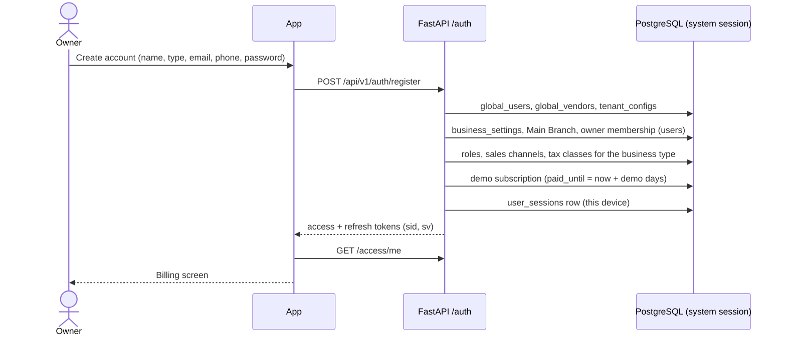

# Auth & Tenant Setup

## Section 1 — For the Customer / Business Owner

### What is this?
The front door to Tallyko. You create your business account (your own private space, a "tenant") and sign in on any device: a laptop browser, an Android tablet or phone, or an iPhone/iPad.

### Why does it exist?
Every business gets its own secure, isolated space. Only you and the staff you add can see your menu, sales and customers. Each person signs in with their own login, so every bill, cancellation and discount is recorded against a name.

### Real-world examples
*   **A new café opens:** the owner taps **Create account**, enters the café name, business type (restaurant, café, cloud kitchen, retail), their name, email, phone and a password. The café is ready immediately, with a free demo period, a default branch, built-in roles, sales channels and GST classes.
*   **Adding a manager:** Settings → Staff → Add. The owner sets the manager's name, email, role and a first password, and hands it over. The manager signs in on their own phone.
*   **A phone is stolen:** Account → Signed-in devices → Sign out that device. It stops working on its next request. Deactivating a staff member signs out all their devices at once.

### Edge cases
*   *Forgot password:* there is no self-service reset yet. The owner resets a staff password in Settings → Staff; Tallyko support resets an owner's password from the console.
*   *Subscription ended:* sign-in still works, but the app shows the renewal screen until the owner renews ([018](./018_Subscriptions_Demo_And_Sessions.md)).
*   *Delete my account:* Settings → Account → Delete account, or the public `/delete-account` page (store requirement).

---

## Section 2 — For the Developer

### Data model
*   Platform: `global_vendors` (the business; `id` = `tenant_id`), `tenant_configs` (status, plan, overrides, `paid_until`, `session_version`, `db_url`), `global_users` (login: email, phone, bcrypt hash, `platform_role`), `user_sessions` (one row per signed-in device).
*   Business: `users` (staff membership: `username` = login email, `role` key, `location_id`), `roles`, `locations`, `business_settings`.
*   Diagrams: [16_erd_platform](../diagrams/mermaid/16_erd_platform.mmd), [17_erd_business](../diagrams/mermaid/17_erd_business.mmd).

### API endpoints
*   `POST /api/v1/auth/register` — `{vendor_name, owner_name, email, phone, password, business_type}`; creates the login, business, config, settings, "Main Branch", roles, channels, tax classes and the demo period, and returns tokens.
*   `POST /api/v1/auth/login` — `{email, password}` (email **or** phone); returns tokens.
*   `POST /api/v1/auth/refresh`, `POST /api/v1/auth/logout` (ends the server session).
*   `GET /api/v1/auth/me`, `POST /auth/change-password` (signs out the login's other devices), `POST /auth/delete-account`.
*   `GET /api/v1/auth/sessions`, `DELETE /auth/sessions/{id}` — signed-in devices.
*   Staff: `GET/POST /api/v1/staff`, `PUT /staff/{id}` (managers can't create or edit owners/managers).

### Response (login / register)
```json
{
  "success": true,
  "access_token": "eyJhbGci…",
  "refresh_token": "eyJhbGci…",
  "token_type": "bearer",
  "account_type": "business",
  "tenant_id": "3f0c…",
  "role": "owner",
  "user": { "id": "…", "email": "owner@cafe.com", "full_name": "…", "role": "owner", "staff_id": "…" },
  "business_name": "Chai Corner",
  "subscription": { "state": "trial", "paid_until": "…", "days_left": 7, "locked": false }
}
```
Platform logins return `account_type: "platform"`, `platform_role`, and no tenant.

### Tokens
*   Access (12 h): `sub`, `tenant_id`, `role`, `staff_id`, `sid`, `sv`. Refresh (30 days): `sub`, `sid`, `sv`.
*   Every request checks the session version and revoked sessions (401) and the subscription lock (402) — see [10_Security_And_Auth.md](../10_Security_And_Auth.md).

### Validation rules
*   Valid email; phone `+` and 6–16 digits; password 8–64 characters; business name 2–100.
*   Sign-up is rate limited (5 per 5 min per IP); login 20 per 15 min per account, 60/min per IP.

### Multi-tenant considerations
Login runs in a system session (it must find the user before any tenant is known). The token's `tenant_id` then selects the tenant session: role `tallyko_app`, `app.current_tenant_id` set, RLS on ([03](../03_Multi_Vendor_Architecture.md)).

### Logging (tracenest)
`[Auth]` lines for sign-up, login success/failure and sign-outs, with `tenant_id`.

### Sequence (sign-up)


### Tests
`backend/tests/integration/test_auth.py`, `test_subscriptions.py` (sessions), `test_tenant_isolation.py`.
