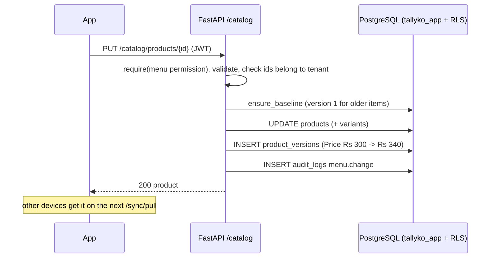

# Product Catalog

## Section 1 — For the Customer / Business Owner

### What is this?
The Product Catalog is the heart of your business in Tallyko. It is where you define everything you sell, how much it costs, and how it is categorized. 

### Why does it exist?
Without a catalog, you can't ring up a sale. We designed this to be much faster and simpler than Shopto. Instead of navigating through multiple confusing menus to add one item, Tallyko lets you add a product, assign it to a category, and set its price all on a single, clean screen. It adapts seamlessly whether you are selling a "Cappuccino" (Restaurant) or scanning a barcode for a "Bottle of Water" (Retail).

### Real-World Examples
*   **The Restaurant Menu:** A restaurant manager creates a category called "Starters" and adds items like "Spring Rolls" (₹150) and "French Fries" (₹100). They tap a toggle to ensure these items print to the kitchen (KOT) when ordered.
*   **The Supermarket Checkout:** A grocery store owner scans the barcode of a new shampoo bottle using their phone camera. Tallyko instantly pulls up a "New Product" screen with the barcode pre-filled, so they just type the name, price, and hit save.

### Edge Cases
*   *What if I want to change a price temporarily?* You can easily edit the price in the catalog, and the change takes effect immediately on all POS terminals and customer QR menus.
*   *What if I have 1,000 items? Do I type them one by one?* No: photograph your printed menu ([010](./010_AI_Menu_Generator.md)) and import the list, or select many items and change them together (bulk edit).
*   *What if I delete an item by mistake?* Deleting only takes it off the menu; it can be switched back on, and every change is kept in the item's history ([019](./019_Owner_Watch_No_Deletes_And_Menu_History.md)).
*   *Different prices on Swiggy and Zomato?* Each item can have its own price or be hidden per channel ([012](./012_Aggregators_And_Cloud_Kitchens.md)).

---

## Section 2 — For the Developer

### Data model (tenant tables, RLS)
*   `product_categories`: `id`, `tenant_id`, `name`, `sort_order`, `is_active`
*   `products`: `id`, `tenant_id`, `category_id`, `brand_id`, `tax_class_id`, `name`, `description`, `base_price`, `cost_price`, `barcode`, `sku`, `unit`, `is_veg`, `print_to_kitchen`, `track_stock`, `low_stock_threshold`, `channel_prices` (JSON), `is_active`, `updated_at`
*   `product_variants` (child of products): `variant_name`, `price_modifier` (API takes the absolute option price)
*   `product_versions`: append-only history ([13_menu_versioning](../diagrams/mermaid/13_menu_versioning.mmd))
*   `products.tax_rate` is deprecated: tax comes from `tax_class_id` via `TaxResolver` ([015](./015_GST_And_Tax_Management.md)).

### API endpoints
*   `GET/POST /api/v1/catalog/categories`, `PUT/DELETE /catalog/categories/{id}` (delete = `is_active` false)
*   `GET /catalog/products` (search, category, paging), `GET /catalog/products/{id}`, `GET /catalog/products/by-barcode/{code}`
*   `POST /catalog/products`, `PUT /catalog/products/{id}`, `DELETE /catalog/products/{id}` (switch off, never erased)
*   `POST /catalog/products/bulk` (bulk edit), `POST /catalog/bulk-import` (from the photo import), `POST /catalog/products/{id}/barcode` (generate one)
*   `GET /catalog/products/{id}/history`, `POST /catalog/products/{id}/history/{version}/restore`
*   POS devices also receive the catalog through `POST /sync/pull`.

### Request (create product)
```json
{
  "name": "Paneer Tikka",
  "category_id": "…",
  "base_price": 220,
  "tax_class_id": null,
  "variants": [{ "name": "Half", "price": 140 }, { "name": "Full", "price": 220 }],
  "channel_prices": { "SWIGGY": { "price": 249 }, "QR": { "available": false } },
  "is_veg": true,
  "print_to_kitchen": true,
  "track_stock": false
}
```

### Validation rules
*   `name` 1–120 characters; prices 0–10,00,000; up to 20 variants.
*   `barcode` (letters, digits, `-`, `.`) must be unique among the business's products (409 otherwise).
*   Category, brand and tax class ids must belong to the business (FK checks bypass RLS, so the router checks them).
*   Plan limits: only `max_staff` is enforced today (`check_limit`); `max_products` is stored on the plan but not checked.

### Multi-tenant considerations
Routes use `require("menu.manage", …)` and `get_tenant_db`; RLS filters every query. The app role can't DELETE products or categories.

### Logging and audit
`menu.change` audit entries (owner's watch) and a `product_versions` row for every change.

### Sequence (edit an item)


### Tests
`backend/tests/integration/test_catalog.py`, `test_owner_controls.py` (history and restore).
