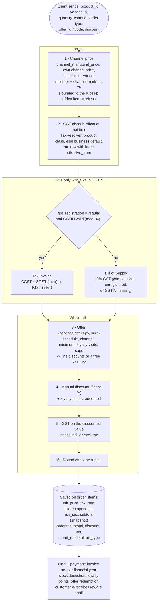
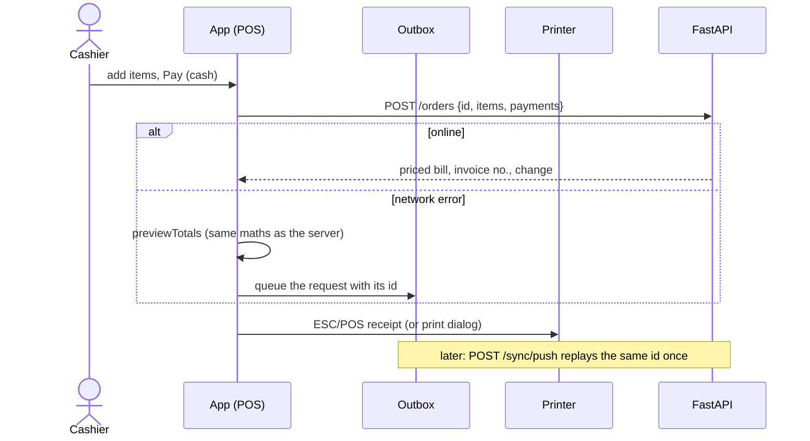

# Core POS Billing

## Section 1 — For the Customer / Business Owner

### What is this?
This is the cash register screen. It is where your staff rings up customers, adds items to a cart, applies discounts, calculates taxes (like GST), and accepts payments (Cash, Card, UPI). It automatically prints a receipt when the order is complete.

### Why does it exist?
Billing is the lifeblood of any business. We researched Shopto and competitors and found their billing screens often feel cluttered. Tallyko's billing screen is designed for pure speed. It has a massive layout for touch targets (so cashiers don't miss buttons during a rush), a lightning-fast barcode scanner mode for retail, and it works flawlessly even if your internet goes down.

### Real-World Examples
*   **The Quick Service Cafe:** A customer orders a Coffee and a Muffin. The cashier taps the two items on the screen, taps the giant green "Cash" button, enters the amount handed to them, and the receipt prints instantly. The whole process takes 3 seconds.
*   **The Retail Store:** The cashier connects a Bluetooth barcode scanner. They just scan items rapidly—*beep, beep, beep*—the cart populates automatically, applies the correct GST, and they complete the checkout.

### Edge Cases
*   *What happens if the internet drops mid-order?* Absolutely nothing changes for the cashier. They keep ringing up orders, and receipts keep printing. Tallyko saves everything locally and automatically syncs to the cloud when the internet comes back.
*   *What if a customer changes their mind about an item?* Remove it from the cart before paying. On a running table bill, items not yet sent to the kitchen are removed straight away; items the kitchen already has need a reason and a manager ([017](./017_Running_Bills_And_Floor.md)).
*   *Can a cashier type a lower price?* No. The server prices every bill from the menu; discounts need the discount permission and are recorded.

---

## Section 2 — For the Developer

### Data model (tenant tables)
*   `orders`: `id` (client-generated UUID allowed), `type` (`DINE_IN`, `TAKEAWAY`, `DELIVERY`, `RETAIL_WALKIN`), `channel`, `status`, `payment_status`, `subtotal`, `discount_amount`, `tax_amount`, `round_off`, `total_amount`, `bill_type`, `supply_type`, `invoice_no`, `code`, offer fields, loyalty points, `waiter_id`, `settled_by`
*   `order_items`: product, variant, quantity, `unit_price`, `tax_rate`, `tax_components`, `hsn_sac`, `subtotal` — a snapshot that never changes when the menu does
*   `payments`: `method` (`CASH`, `CARD`, `UPI`, `WALLET`, `AGGREGATOR`, `CREDIT`, `OTHER`), `amount`, `reference`
*   Full ERD: [17_erd_business](../diagrams/mermaid/17_erd_business.mmd)

### API endpoints
*   `POST /api/v1/orders` — create a bill (counter sale with payments, or an open table bill).
*   `POST /orders/{id}/pay` — payments (split, cash change), optional discount, points, offer.
*   `GET /orders`, `GET /orders/{id}` — history, reprint; `POST /orders/{id}/cancel` with a reason.
*   `POST /sync/push` — the same create request, replayed from the offline outbox ([07](../07_Offline_Sync_Strategy.md)).

### Request (counter sale)
```jsonc
{
  "id": "6f1c…",                     // generated on the device: idempotency key
  "order_type": "TAKEAWAY",
  "channel": "POS",
  "items": [
    { "product_id": "P12", "quantity": 1 },
    { "product_id": "P15", "variant_id": "V2", "quantity": 2 }
  ],
  "customer_phone": "9876543210",
  "discount": { "type": "percent", "value": 10 },
  "payments": [{ "method": "CASH", "amount": 500 }],
  "auto_offers": true
}
```
No prices or totals are sent. The response is the priced order with `change` for cash.

### Pricing
The server prices every bill in this order: channel price → GST class in effect at that time → offer → manual discount → GST on the discounted value → round to the rupee. GST applies only with a valid GSTIN; otherwise the bill is a Bill of Supply.

<!-- diagram: 05_pricing_pipeline drawio=Tallyko_Order_Flow -->


*Diagram source: [`05_pricing_pipeline.mmd`](../diagrams/mermaid/05_pricing_pipeline.mmd) · [SVG](../diagrams/rendered/05_pricing_pipeline.svg) · draw.io: [`Tallyko_Order_Flow.drawio`](../diagrams/Tallyko_Order_Flow.drawio)*
<!-- /diagram -->

When the bill is fully paid it becomes `completed`: invoice number for the financial year, stock deduction, loyalty points, offer redemption and customer emails. Lifecycle: [06_order_lifecycle](../diagrams/mermaid/06_order_lifecycle.mmd).

### Validation rules
*   1–200 items, quantity 1–9999; percent discount ≤ 100; up to 10 payments.
*   Every product, variant, table, customer and brand id must belong to the business and be sold on the chosen channel.
*   Discounts and points need `orders.discount` and must be applied before the first payment.
*   Offline `created_at` is kept, clamped to "not in the future and not older than 30 days".

### Multi-tenant considerations
`require("orders.create")` + `get_tenant_db`; the tenant comes from the token, RLS underneath. The client's `id` is unique across the database, so a replay returns the existing bill.

### Logging (tracenest)
`[Billing]` lines for created, paid and cancelled bills with `tenant_id`; `[Sync]` for pushes. Cancels and discounts are written to the audit log (owner's watch).

### Sequence (sale that goes offline)


### Tests
`backend/tests/integration/test_orders.py`, `test_sync.py`, `backend/tests/unit/test_pricing.py`, `frontend/src/lib/__tests__/gstin.test.ts`.
