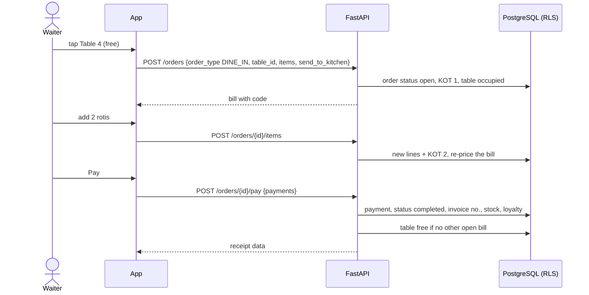

# Table Management (Restaurant POS)

## 1. Overview
Dine-in restaurants see their floor at a glance, open bills on tables, keep adding rounds, and settle when guests leave. A table can carry **several bills** (two parties, or one bill per guest). What happens to a running bill in detail (item kitchen status, cancel, on the house, split, merge) is in [017](./017_Running_Bills_And_Floor.md).

## 2. Key capabilities
* **Floor view:** tables grouped by section, free or occupied, with each open bill's amount, time since opening, kitchen progress and waiter. Colours warn when a table has been open long (thresholds in Settings, `ops_thresholds`).
* **Running bills:** tap a table to open its bill and add rounds; each round goes to the kitchen as a new KOT.
* **Several bills per table:** "Bill 2" or a guest's name (`bill_label`); opening a second bill is an explicit action.
* **Transfer, split, merge:** move a bill to another table, move items to another bill, merge bills.
* **Assigned waiter:** a table can have an assigned waiter; every bill records who took it and who settled it.
* **QR ordering:** each table has a QR code for customers to order on their own bill ([011](./011_Online_Store.md)).
* **Removing a table** switches it off (`is_active`); it is never erased.

## 3. How to use

### A. Opening a bill
1. Open **Tables** and tap a free table.
2. Billing opens for that table. Add items and tap **Send to kitchen** (KOT); the bill stays open and the table shows as occupied.

### B. Adding a round
1. Tap the occupied table and choose its bill.
2. Add items and send them. Only the new items go to the kitchen, as a new KOT; the bill total updates.

### C. Settling
1. Tap the table → the bill → **Pay**. Split payments and cash change are supported; discounts and offers apply before the first payment.
2. When the bill is fully paid it becomes completed (invoice number, stock, loyalty). The table becomes free when its last open bill is closed.

## 4. Under the hood

`tables` has `status` (`free`/`occupied`), `section`, `capacity`, `assigned_staff_id`, `is_active`. Bills are ordinary `orders` with `table_id`, status `open` until paid. `GET /tables` returns `open_bills` per table with kitchen progress counts.

Bill states: [06_order_lifecycle](../diagrams/mermaid/06_order_lifecycle.mmd) · draw.io: [`Tallyko_Order_Flow.drawio`](../diagrams/Tallyko_Order_Flow.drawio).

**API:** `GET/POST /tables`, `PUT /tables/{id}`, `DELETE /tables/{id}` (switch off), `POST /orders` (`table_id`, `new_bill`, `bill_label`), `POST /orders/{id}/items`, `POST /orders/{id}/transfer`, `PUT /orders/{id}/details` (label, guests), `POST /orders/{id}/pay`.

**Tests:** `backend/tests/integration/test_floor.py`, `test_orders.py`.
