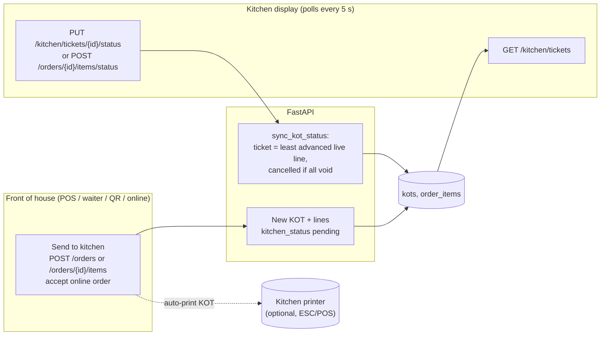
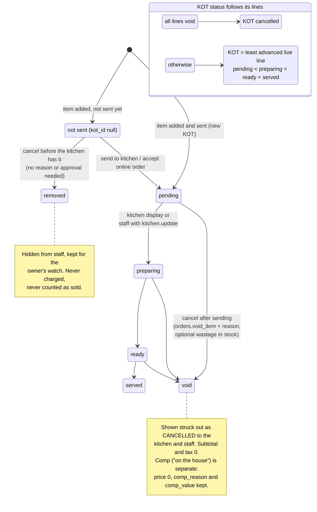

# Kitchen Display System (KDS) & KOTs

## 1. Overview
The kitchen display replaces paper tickets. It is the same Tallyko app signed in with a **kitchen** role, on a wall TV, a tablet or a phone. Every time items are sent to the kitchen, a **KOT** (kitchen order ticket) appears; cooks move each item through Preparing → Ready → Served. A KOT can also be printed on a kitchen printer.

## 2. Key capabilities
* **Tickets appear within seconds:** the display polls the server every 5 s. There are no WebSockets and no LAN-only device-to-device protocol.
* **Per-item status:** every line has its own status, so "2 ready, 2 cooking" is visible. The ticket shows the slowest live line.
* **Timers and colours:** tickets turn amber/red after the thresholds set in Settings (`kitchen_amber_min`, `kitchen_red_min`).
* **Cancelled items struck out:** items cancelled after the kitchen had them show as **CANCELLED**, so nobody cooks them.
* **Brands:** in cloud kitchens each ticket shows its brand.
* **No kitchen screen?** Staff with `kitchen.update` mark items ready/served from the bill ([017](./017_Running_Bills_And_Floor.md)).
* **Offline:** the kitchen display needs the server. A shop that must keep the kitchen running during internet outages runs the server on a shop PC ([17](../17_Free_Cloud_Deployment.md)); printed KOTs from the POS also work.

## 3. How to use
1. Sign in on the kitchen device with a kitchen account and open **Kitchen**.
2. Each ticket shows table or token, channel/brand, time elapsed and its items with notes.
3. Tap an item (or the whole ticket) to move it to **Preparing**, then **Ready**. Waiters see the progress on the table and the bill; customers who ordered by QR see it on their phone.
4. **Served** removes the item from the active queue.

## 4. Under the hood

Item and ticket states:

<!-- diagram: 07_kitchen_item_status drawio=Tallyko_Order_Flow -->

*Diagram source: [`07_kitchen_item_status.mmd`](../diagrams/mermaid/07_kitchen_item_status.mmd) · [SVG](../diagrams/rendered/07_kitchen_item_status.svg) · draw.io: [`Tallyko_Order_Flow.drawio`](../diagrams/Tallyko_Order_Flow.drawio)*
<!-- /diagram -->

**API:** `GET /kitchen/tickets?status=active|ready|recent|all` (per-line status, bill label), `PUT /kitchen/tickets/{id}/status` (whole ticket), `POST /orders/{id}/items/status` (single items). `GET /kitchen/kds/orders` and `PUT /kitchen/kds/orders/{kot_id}/status` remain for older app versions.

**Tests:** `backend/tests/integration/test_kitchen.py`, `test_floor.py`.
