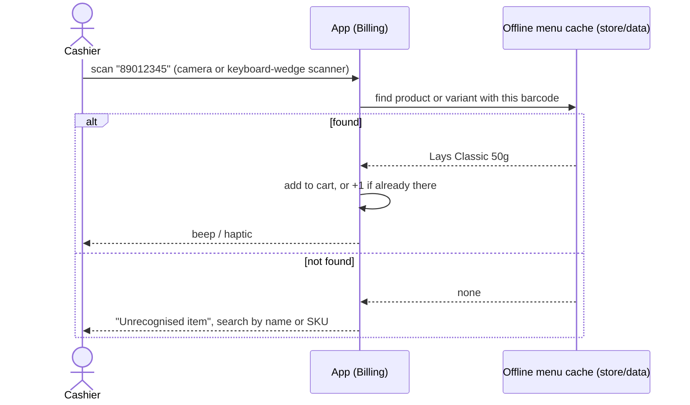

# Barcode Scanner & Retail Billing

## 1. Overview
While restaurants use visual grids for menus, retail businesses (grocery, pharmacy, apparel) rely heavily on speed and volume. The Scanner feature transforms the mobile device's camera into a high-speed barcode/QR code reader, allowing cashiers to rapidly add items to a cart.

## 2. Key Capabilities
* **Rapid Hardware/Software Scanning:** Supports the built-in device camera, or integrates seamlessly with physical Bluetooth/USB barcode guns.
* **Variant Support:** Scanning a specific barcode automatically resolves to the exact product variant (e.g., Red T-Shirt vs Blue T-Shirt).
* **Auto-Increment:** Scanning the same item twice automatically bumps the quantity to 2, rather than adding a duplicate line item.
* **Fallback Search:** If a barcode is unreadable, cashiers can quickly search by SKU or product name in the same interface.

## 3. How to Use

### A. Setting Up Barcodes (In Catalog)
1. Go to **Menu** (items).
2. When creating or editing a product, locate the `Barcode/SKU` field.
3. Type or scan the product's barcode, or let Tallyko generate one (`POST /catalog/products/{id}/barcode`) and print labels (Code128 / EAN-13).

### B. High-Speed Billing
1. Open **Billing**. A USB/Bluetooth scanner works straight away (it types the code and Enter); on a phone or tablet tap the scan button to use the camera.
3. Hold the barcode in front of the camera.
4. The item is instantly added to the current cart. A subtle beep/haptic feedback confirms success.
5. Once all items are scanned, tap **Proceed to Checkout**.

## 4. Under the Hood (Data Flow)

Lookup happens on the device against the offline menu cache (`store/data`), so scanning works without internet. The server lookup `GET /catalog/products/by-barcode/{code}` is used by management screens.

The bill itself also carries a barcode (its short `code`), so a receipt can be scanned to find the bill later. Encoders: `frontend/src/lib/barcode/` (Code128, EAN-13, QR), tested in `frontend/src/lib/barcode/__tests__`.
