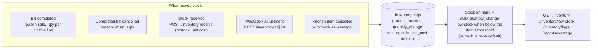

# Inventory Management

## 1. Overview
The Inventory Management module is the backbone for operational efficiency, ensuring that businesses never unknowingly run out of stock and can trace every missing item. It supports both simple quantity tracking and complex multi-variant tracking.

## 2. Key Capabilities
* **Real-Time Deduction:** Stock levels are automatically reduced the exact second an order is completed.
* **Low-Stock Alerts:** Visual indicators and dashboard warnings when an item drops below its defined threshold.
* **Audit Trail (Ledger):** Instead of just overwriting a number (e.g., changing 50 to 45), the system maintains an immutable ledger of transactions (e.g., `-5 sold`, `+20 purchased`, `-1 wasted`).
* **Wastage Tracking:** Allows staff to log spoiled or damaged goods, keeping inventory accurate and providing insights into operational losses.

## 3. How to Use

### A. Initializing Stock
1. Go to **Menu** and create or edit an item.
2. Toggle **Track Inventory** to ON.
3. Enter the current physical stock count and the **Low Stock Alert** threshold.

### B. Viewing and Managing Stock
1. Navigate to the **Inventory** tab on the bottom navigation bar.
2. A searchable list of all tracked items appears. Items below their threshold are highlighted in red.
3. Tap on any item to view its **Stock Ledger** (history of all additions, sales, and deductions).

### C. Adding Stock (Receiving Delivery)
1. In the **Inventory** tab, tap the `+` or `Add Stock` button.
2. Select the product, enter the quantity received from the supplier, and optionally enter the purchase price.
3. The new quantity is appended to the ledger and the total stock is dynamically updated.

### D. Logging Wastage
1. Select a product in the **Inventory** tab.
2. Tap **Log Wastage/Damage**.
3. Enter the quantity to remove and a brief reason (e.g., "Dropped on floor"). The stock is reduced accordingly.

## 4. Under the Hood (Data Flow)

Stock on hand is the sum of `inventory_logs.quantity_change` per product: an append-only ledger the app's database role cannot delete from. Only products with `track_stock` are counted.

Offline bills apply as differences when they sync, so nothing is overwritten. Tests: `backend/tests/integration/test_orders.py` (stock deduction and reversal), `test_floor.py` (wastage on cancel).
