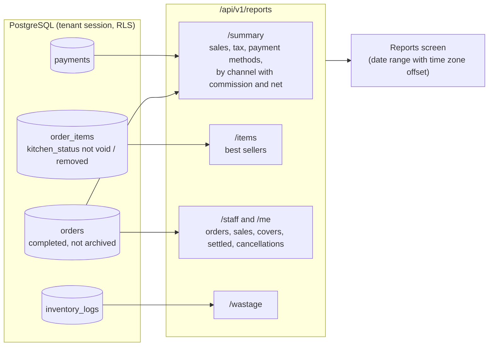

# Analytics & Reporting

## 1. Overview
The Analytics module transforms raw transaction data into actionable business intelligence. It provides owners and managers with a high-level overview of business health, as well as granular reports necessary for accounting and optimization.

## 2. Key Capabilities
* **Real-Time Dashboards:** Instantly view today's total sales, order volume, and average order value.
* **Best Sellers Identification:** Automatically ranks products by sales volume and revenue generated.
* **Trend Analysis:** Visual charts comparing sales across different days, weeks, or months to identify peak operational hours.
* **Exportable Reports:** CSV export of reports from the Reports screen (generated on the device). PDF reports and emailing an accountant are not built.

## 3. How to Use

### A. The Daily Snapshot
1. Open **Reports**.
2. The default view shows "Today's Performance".
3. You will see summary cards for **Gross Revenue**, **Total Orders**, and **Active Tables** (if applicable).
4. A pie chart breaks down revenue by payment method (Cash vs Card vs UPI).

### B. Analyzing Product Performance
1. Scroll down on the Reports screen to the **Top Items** section.
2. The list displays the most frequently sold items for the selected time period.
3. This data helps you make informed purchasing decisions and adjust menu/catalog pricing.

### C. Deep Dive Reports (not built yet)
1. Tap the **Generate Report** button (often found in the top right).
2. Select the report type: *Sales Summary*, *Tax/GST Ledger*, or *Staff Performance*.
3. Choose a custom date range.
4. The system will compile the data and offer a download link or an option to email the report directly to an accountant.

## 4. Under the Hood (Data Flow)

Reports are SQL aggregations over the tenant's own rows (RLS), run on request. Cancelled bills, void and removed lines, and archived bills are excluded. There is no separate analytics database, queue or PDF generator.

**Permissions:** `/summary` needs `reports.view` and the `reports` module; items, wastage and staff need the `advanced_reports` module (staff also `staff.view`); `/reports/me` needs `reports.view_own` so staff see their own numbers.
