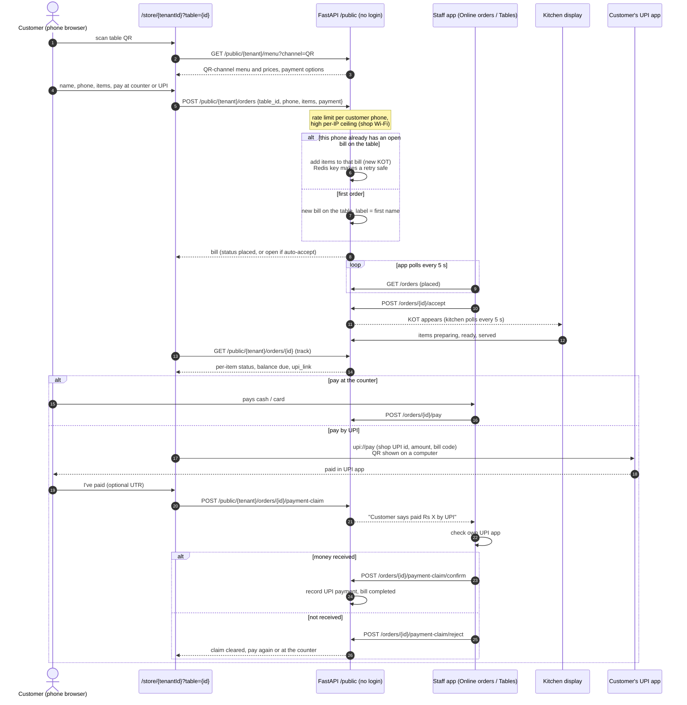

# Online Store & QR Menus

## 1. Overview
In the modern commerce era, an omnichannel presence is essential. Tallyko automatically provisions a public-facing online storefront for every registered tenant. For restaurants, this acts as a QR-code digital menu for dine-in ordering, or a delivery portal. For retail stores, it functions as an e-commerce storefront. Best of all, it shares the exact same database as the POS, meaning inventory and catalog updates sync instantly.

## 2. Key Capabilities
* **Zero-Setup Storefront:** Every business has a store page at `/store/{tenantId}`; the owner switches it on in Settings (`store_enabled`).
* **Unified Menu and Stock:** The store reads the same menu (with ONLINE / QR channel prices and availability). Online bills deduct stock like counter bills when they complete; an item switched off or hidden on the channel disappears from the store.
* **QR Code Ordering:** Restaurants can print QR codes placed on physical tables. When scanned, customers can view the menu, select items, and place orders directly to the Kitchen (KDS).
* **Commission-Free:** Unlike food delivery aggregators, orders placed through the Tallyko store are completely commission-free for the vendor.

## 3. How to Use

### A. Accessing the Store Link
1. Open **Settings → Business → Online ordering** and switch on the store and/or QR table ordering.
2. The screen shows your store link (`https://<your server>/store/<business id>`) with a QR code to print or share.
3. Table QR codes are printed from **Tables**.

### B. The Customer Experience (QR Menu / Dine-in)
1. A customer sits at Table 5 and scans the QR code on the table.
2. Their phone's browser opens the store link with `?table=<table id>`.
3. They browse the catalog, add a Burger and Fries to their cart, and tap **Place Order**.
4. The order appears in **Online orders** and on the table within seconds (the staff app polls every 5 s). Staff accept it, unless the QR channel auto-accepts.
5. The kitchen display then shows a new ticket for Table 5.

### C. Managing Online Orders
1. Online orders appear seamlessly within the main POS workflow.
2. In the **Tables** or **Kitchen** views, these orders are processed exactly like orders punched in manually by a waiter.
3. Once fulfilled, the order is settled via the standard billing checkout process.

## 3a. Table QR ordering (current behaviour)

**Turning it on.** Settings → QR table ordering:
- an on/off switch;
- how customers pay: **at the counter / to the waiter**, **by UPI now**, or both. UPI needs the shop's UPI ID;
- whether staff must confirm each order before it goes to the kitchen.

Print the table QR codes from Tables.

**The customer's flow.**
1. Scan the table's code to see the menu, with QR prices. Items hidden from the QR menu aren't shown.
2. Order with a name and phone number.
3. Track the order: waiting for confirmation, in the kitchen, then each item ready or served.
4. Order more at any time. Re-orders go on the same bill as a new kitchen ticket.

**Several parties at one table.** Each customer (by phone number) gets their own bill on the table, so nobody pays for another party's food.

**Paying.**
- *Counter:* the bill shows "Please pay at the counter, bill #CODE"; the cashier settles it as usual.
- *UPI:*
  1. "Pay ₹X by UPI" opens the customer's UPI app with the shop's UPI ID and the amount filled in. On a computer, a QR code is shown instead.
  2. The customer taps **I've paid**, optionally adding the UTR.
  3. Staff see "Customer says paid ₹X by UPI". They check their UPI app and tap **Confirm**, which records a UPI payment and closes the bill, or **Not received**.

  No payment gateway is used, by design: everything stays free.

**API.**
- `GET /public/{tenant}/menu?channel=QR`
- `POST /public/{tenant}/orders` with `payment: counter|upi`
- `POST /public/{tenant}/orders/{id}/payment-claim`
- `GET /public/{tenant}/orders/{id}`
- Staff: `POST /orders/{id}/payment-claim/confirm|reject`
- Test: `test_public_and_integrations.py::test_table_qr_two_parties_and_upi_claim`.

## 4. Under the Hood (Data Flow)

The store and QR pages are routes of the same Expo web app (`frontend/src/app/store/[tenantId].tsx`), served by Caddy like every other page. They call the public API, which needs no login and uses `get_public_tenant_db` (RLS scoped to the `tenant_id` in the path). Staff screens (Online orders, Tables, Kitchen) poll every 5 s; there are no push notifications or WebSockets.

<!-- diagram: 09_qr_table_ordering drawio=Tallyko_QR_Table_Ordering -->

*Diagram source: [`09_qr_table_ordering.mmd`](../diagrams/mermaid/09_qr_table_ordering.mmd) · [SVG](../diagrams/rendered/09_qr_table_ordering.svg) · draw.io: [`Tallyko_QR_Table_Ordering.drawio`](../diagrams/Tallyko_QR_Table_Ordering.drawio)*
<!-- /diagram -->

Public orders from the **online store** follow the same path without a table: they arrive as `placed` in Online orders (or `open` when the ONLINE channel auto-accepts), and the customer tracks them on the same page. When the business's subscription is locked, the public pages stop taking orders (402).
