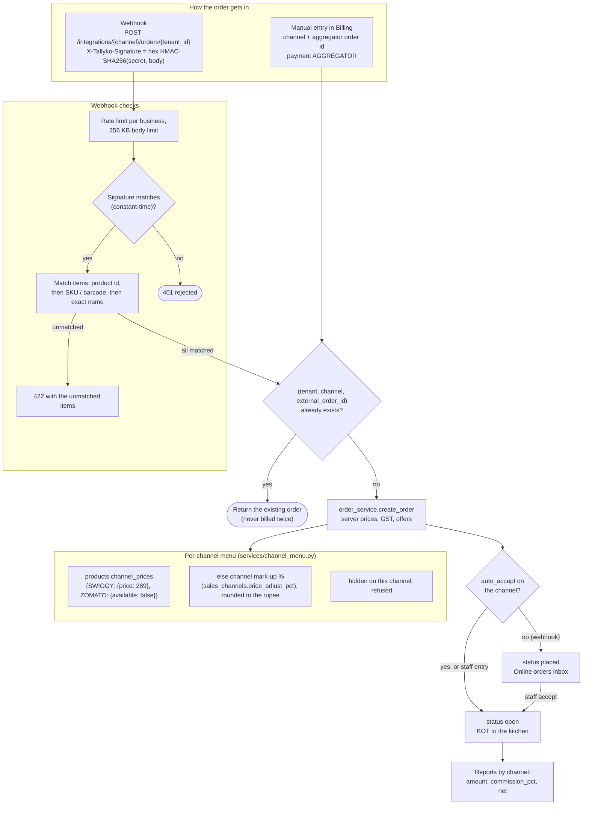

# Aggregators (Swiggy, Zomato, ONDC, magicpin) & Cloud Kitchens

## For the business owner

**Online orders in one place.** Orders from Swiggy, Zomato, ONDC, magicpin, phone orders, your own online store and QR table ordering all land in **Online orders**, go to the kitchen as tickets, and appear in reports by channel — with the aggregator's commission subtracted so you see your real earnings.

**How orders get in**
- **Typing them in (works for everyone, today):** in Billing pick the channel (e.g. Swiggy), enter the aggregator's order ID, add items and mark it paid online. Takes the same few taps as a counter bill. Re-entering the same order ID never double-bills.
- **Automatic (webhook):** Swiggy and Zomato only push orders directly to *approved POS partners*, which requires their partner onboarding. ONDC seller apps and custom bridges can push orders to Tallyko's webhook (Settings → Sales channels → Integration).

**Per-channel settings** (Settings → Sales channels): turn a channel on/off, commission % (for net-payout reports), menu mark-up % (aggregator prices are often higher than counter prices — applied automatically), auto-accept.

**Different prices and menus per app:** each menu item can have its own price on Swiggy, Zomato, ONDC, the online store or QR, and can be left off any of them (e.g. a "Swiggy Saver Combo" only on Swiggy, a family pack only on Zomato). Items without their own app price use that channel's mark-up %. Settings → Sales channels → *View menu* shows exactly what each app sells, with export for the partner portal. Billing refuses an item that isn't on the chosen channel's menu.

**Cloud kitchens:** create brands (Settings → Brands), e.g. "Biryani Box" and "Wrap Republic" from the same kitchen. Tag menu items and orders with a brand; the kitchen display shows which brand each ticket belongs to.

## For the developer

<!-- diagram: 15_aggregator_orders -->


*Diagram source: [`15_aggregator_orders.mmd`](../diagrams/mermaid/15_aggregator_orders.mmd) · [SVG](../diagrams/rendered/15_aggregator_orders.svg)*
<!-- /diagram -->


- Tables: `sales_channels` (per tenant: code, enabled, commission_pct, price_adjust_pct, external_store_id, webhook_secret, auto_accept), `brands`; `orders.channel`, `orders.external_order_id`, `orders.brand_id`, `orders.commission_amount`. Defaults are created at signup (`settings_service.DEFAULT_CHANNELS`).
- Manual entry: `POST /api/v1/orders` with `channel`, `external_order_id`, `payments: [{method: "AGGREGATOR", ...}]`. `(tenant, channel, external_order_id)` is de-duplicated in `order_service.create_order`.
- Webhook: `POST /api/v1/integrations/{channel}/orders/{tenant_id}`, header `X-Tallyko-Signature: hex(HMAC_SHA256(webhook_secret, raw_body))`. Body:
  ```json
  {"external_order_id": "ZO-77", "order_type": "DELIVERY", "customer_name": "Neha", "customer_phone": "9876543210",
   "delivery_address": "…", "notes": "…", "prepaid": true,
   "items": [{"sku": "CB-01", "quantity": 2}, {"name": "Butter Naan", "quantity": 4}, {"product_id": "<uuid>", "quantity": 1}]}
  ```
  Items match by product id, then SKU/barcode, then exact name; unmatched items → 422 with the list. Orders arrive as `placed` (or `open` with auto-accept); prepaid orders get an `AGGREGATOR` payment. Rate limited per tenant; 256 KB body limit; constant-time signature comparison; secrets rotate via `POST /api/v1/channels/{code}/rotate-secret` (owner).
- Per-channel menu: `products.channel_prices` = `{"SWIGGY": {"price": 289}, "ZOMATO": {"available": false}}` — one place decides price and availability (`app/services/channel_menu.py`), used by billing, offers, the public menu (`?channel=ONLINE|QR`) and `GET /api/v1/channels/{code}/menu`. Test: `test_orders.py::test_each_aggregator_has_its_own_prices_and_menu`. Demo: `owner.cloud@example.com` (Biryani Box Cloud Kitchen).
- Reports: `GET /api/v1/reports/summary` → `by_channel[] {orders, amount, commission, net}`.
- Tests: `backend/tests/integration/test_orders.py::test_manual_aggregator_order_with_commission`, `test_public_and_integrations.py::test_aggregator_webhook`.
