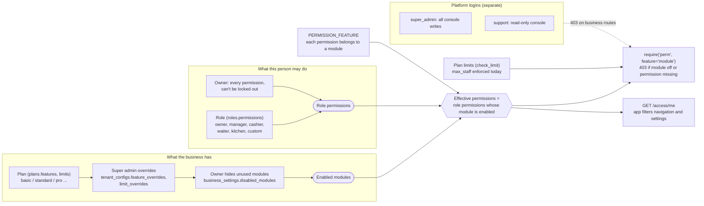

# 013 · Staff, Roles & Access Control

Tallyko has to fit a one-person kirana and a 5-star restaurant with 40 staff. Access is decided by two independent things:

1. **What the business has.** The **plan's modules**, minus modules the **owner hid** because they don't use them. For example, a dhaba can hide Swiggy/Zomato and Staff accounts.
2. **What this person may do.** The **permissions** of their role.

A person can use a screen only when both allow it. The server enforces this on every request; the app hides what isn't allowed.

## Roles

- **Built-in roles:**

  | Role | Typical use |
  |---|---|
  | Owner | Everything; can't be restricted |
  | Manager | Runs the shop |
  | Cashier | Billing and payments |
  | Waiter | Table orders, no payments |
  | Kitchen | Kitchen display only |

- The owner can adjust built-in roles, or reset them to the defaults.
- With the **custom roles** module, the owner can create roles such as "Billing only" or "Captain" from ~30 permissions grouped by area: Billing, Tables, Kitchen, Menu, Inventory, Customers, Offers, Reports, Staff, Settings.
- Notable permissions:
  - `orders.view_all`: without it, a waiter sees only the orders they took.
  - `customers.view_contact`: without it, phone numbers are masked.
  - `orders.void_item`: remove items already sent to the kitchen.
  - `orders.discount`: manual discounts and loyalty redemption.
- Managers can't create, edit or remove owners or managers. Only the owner edits roles.
- Plan limits: `max_staff` is enforced when adding or re-activating staff. `max_products` and `max_locations` are stored on plans but not checked yet.

## Waiters & accountability

- Every order records **who took it** (`waiter_id`) and **who settled it** (`settled_by`).
- Tables can have an **assigned waiter**.
- **Staff performance** (`/reports/staff`) shows each person's orders, sales, average bill, tables served, covers, bills settled, amount collected and cancellations. `/reports/me` shows a staff member their own numbers.
- The **activity log** (`/audit`, `audit.view`) records sensitive actions:
  - discounts, voids and cancellations;
  - role and staff changes;
  - offer and tax changes;
  - module changes.

## Platform level

Tallyko staff use separate **platform logins** (`super_admin`, `support`) that can't touch any business's orders. They manage plans, per-business feature overrides and subscriptions. See [016](./016_Super_Admin_Console.md).

## Developer notes

<!-- diagram: 04_access_model drawio=Tallyko_Access_And_Sessions -->

*Diagram source: [`04_access_model.mmd`](../diagrams/mermaid/04_access_model.mmd) · [SVG](../diagrams/rendered/04_access_model.svg) · draw.io: [`Tallyko_Access_And_Sessions.drawio`](../diagrams/Tallyko_Access_And_Sessions.drawio)*
<!-- /diagram -->

- Catalogue in `app/core/catalog.py`: `PERMISSIONS`, `SYSTEM_ROLES`, `FEATURES`, `PERMISSION_FEATURE`, `DEFAULT_PLANS`.
- Effective permissions = role permissions ∩ permissions whose module is enabled. Enabled modules = plan features + `tenant_configs.feature_overrides` − `business_settings.disabled_modules`. Owners get every permission (they can't lock themselves out) but still only their plan's modules.
- `app/services/access.py`:
  - `require("perm", feature="x", any_of=…)` is the FastAPI dependency every router uses.
  - Entitlements and role permissions are cached in-process for 30 s.
  - `invalidate()` is called after role, plan or module changes.
- `GET /access/me` returns role, permissions, features and plan. The app caches it (`frontend/src/store/access.ts`) and filters navigation and settings with it.
- Tests: `tests/integration/test_access_and_platform.py`.

Request order (session checks, 402 lock, then `require`): [03_request_pipeline](../diagrams/mermaid/03_request_pipeline.mmd).
