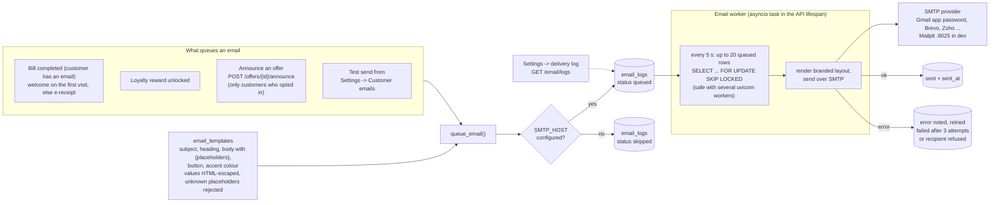

# 014 · Offers, Loyalty Rewards & Customer Email

## For the business owner

**Offers & rewards** (sidebar) lets you create discounts that apply on their own, or when a cashier picks them, or when a customer quotes a code.

**What the customer gets**
- **% off** the bill, with an optional maximum (for example "20% off, max ₹150").
- **₹ off** the bill.
- **A free item**, for example a free dessert, or "on the house".

**What it applies to**
- The **whole bill**, optionally above a minimum amount.
- **Specific items or categories**, for example 10% off all biryanis.
- **Loyalty reward**: only for customers who visited at least *N* times in the last *D* days, optionally above a minimum amount. Example: "came 5 times this month and spends over ₹500 → 20% off".

**When it runs**
- Start and end dates.
- Days of the week.
- A daily time window. Overnight windows such as 10 pm–2 am work.
- Channels: counter, QR, online store, Swiggy…
- Order types: dine-in, takeaway, delivery.

**Limits**
- Total uses.
- Uses per customer.
- A coupon code.
- Priority.
- **Switch it off instantly** from the list at any time.

**Billing**
- At billing the POS shows which offers apply to the current cart and why the others don't, for example "Add ₹120 more".
- The best *auto-apply* offer is pre-selected. The cashier can change or remove it.
- The server re-checks every offer when the bill is saved, so a stale screen can't give a wrong discount.

**Customer emails** (Settings → Customer emails)
- Templates for a reward unlocked, an offer announcement, an e-receipt and a welcome email.
- Edit the subject, heading, text, button and brand colour, using placeholders like `{customer_name}` and `{offer_details}`.
- Preview before saving, send a test to yourself, and see the delivery log.
- **Announce** an offer from the offers list. It is emailed only to customers who agreed to receive offers (the consent switch on the customer form).

## Permissions & plans

| Action | Needs |
|---|---|
| See and apply offers when billing | `offers.apply` + `offers` module |
| Create, edit or switch off offers | `offers.manage` |
| Loyalty-type offers | `loyalty` module |
| Edit templates, announce offers | `email.manage` + `email` module |

## How it works (developer)

**Engine** — `app/services/offers.py`:
- `evaluate(offer, OfferContext)` is pure, with no database access: easy to test and reuse.
- It checks schedule (local time zone), days, time window, channel, order type, minimum, item scope, loyalty visits within the window, code, and usage caps.
- It returns an `OfferResult` with `eligible`, `reason`, `discount` and per-line `line_discounts`.
- `best_offer` picks the largest eligible discount.

**Pricing** — `price_order(..., line_discounts=…)`:
- Item offers reduce specific lines before GST.
- Bill offers spread proportionally.
- Free items are added as ₹0 lines whose note starts with `Free — `.
- The order stores `offer_id`, `offer_name` and `offer_discount`.

**Redemption**
- An `OfferRedemption` row (unique per order) is written when the bill completes.
- `uses_count` is incremented at the same time.
- Cancelling the bill reverses both.

**Endpoints**
- `GET/POST /offers`, `PUT /offers/{id}`, `PUT /offers/{id}/active`.
- `POST /offers/evaluate` takes a cart that isn't an order yet.
- `POST /offers/{id}/announce`.
- Orders accept `offer_id`, `offer_code` and `auto_offers` on create; `offer_id` and `remove_offer` on pay; and `GET/POST /orders/{id}/offers|offer`.

**Email**
- `app/services/email/`:
  - `templates.py`: safe `{placeholder}` filling; values are HTML-escaped and unknown placeholders rejected.
  - Branded responsive layout.
  - `service.py`: `queue_email` writes `email_logs`; a background worker started in the app lifespan delivers over SMTP with retries.
- The worker is an asyncio task in the API process (no Celery or broker): every 5 s it takes up to 20 queued rows with `FOR UPDATE SKIP LOCKED`, sends them, and marks them `sent`, or `failed` after 3 attempts.
- Any SMTP works, including the free tiers of Gmail app passwords, Brevo and Zoho. In production, pass `SMTP_*` to the backend service (the prod compose file doesn't yet).
- In development every email goes to **Mailpit** (http://localhost:8025) and nothing leaves the machine.
- Without `SMTP_HOST`, emails are logged as `skipped`.

<!-- diagram: 14_email_pipeline -->

*Diagram source: [`14_email_pipeline.mmd`](../diagrams/mermaid/14_email_pipeline.mmd) · [SVG](../diagrams/rendered/14_email_pipeline.svg)*
<!-- /diagram -->

Where the offer sits in the bill maths: [05_pricing_pipeline](../diagrams/mermaid/05_pricing_pipeline.mmd). Offers are evaluated online only; bills made offline sync without an offer.

**Tests:** `tests/integration/test_offers.py`, `tests/integration/test_taxes_and_email.py`.
