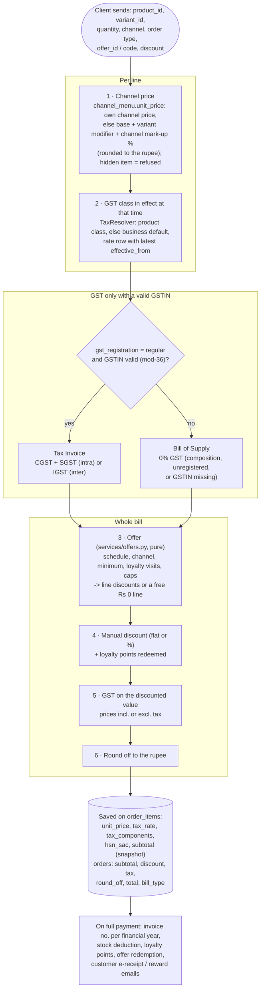

# 015 · GST & Tax Management

## For the business owner

Every item belongs to a **tax class**, such as "Restaurant service 5%" or "GST 18%". The bill uses whatever rate that class has **at the moment the bill is made**, and splits it into **CGST + SGST**, or **IGST** for an inter-state supply.

When the government changes a rate (for example the GST 2.0 slabs from 22 Sep 2025), you don't edit every item:

1. Open **Settings → GST & taxes**.
2. Pick the class.
3. Choose **Schedule a rate change**.
4. Enter the new rate, the date it starts, and the notification number.

Bills switch automatically at that moment. **Bills already issued never change**, because each bill line keeps a copy of the tax it was charged.

Most businesses don't even need to do that. Classes created from the **Tallyko GST library** "follow" it. When Tallyko publishes a new government rate, your class picks it up on the same date. If you schedule your own change, that class stops following the library, so your choice is never overwritten.

Your **registration type** decides the bill:

| Registration | Document | GST on bill |
|---|---|---|
| Regular | Tax Invoice | CGST + SGST (or IGST) |
| Composition scheme | Bill of Supply | none |
| Not registered | Bill of Supply | none |

GST is charged only with a **valid GSTIN** (15 characters, state code, PAN pattern, mod-36 check character). A "regular" business without one gets a Bill of Supply and a warning ([019](./019_Owner_Watch_No_Deletes_And_Menu_History.md)).

## Who can do what

- **Owner / manager** (`settings.manage`):
  - create and edit classes;
  - schedule or cancel upcoming changes;
  - bulk-assign classes to items or categories;
  - set the default class;
  - choose whether menu prices include tax.
- **Super admin**: maintains the platform GST library (`/platform/tax/presets`) and publishes new rate versions for everyone who follows a preset.
- Everyone else sees rates read-only.

## How it works (developer)

- **Models** (`app/models/tax.py`):
  - `TaxPreset` / `TaxPresetRate`: the platform library, versioned by `effective_from`.
  - `TaxClass` / `TaxClassRate`: per business. A class has `preset_key` and `follow_preset`.
  - Rates are rows with `effective_from`, `total_rate` and `components` (`[{name: "CGST", rate}, …]`).
- **Seeding:**
  - Defaults are in `app/core/catalog.py` (`DEFAULT_TAX_PRESETS` and `DEFAULT_TAX_CLASSES` per business type).
  - `ensure_tax_classes` runs at signup and lazily on `GET /taxes`.
- **Pricing:**
  - `TaxResolver.load(db, tenant, settings, at=now)` picks the rate in effect for each product: its class, else the business default class, else the legacy `products.tax_rate`.
  - Composition and unregistered businesses charge 0% and produce `bill_type = "bill_of_supply"`.
- **Snapshot:** every `order_items` row stores `tax_components` and `hsn_sac`, so reprints, reports and returns are stable after a rate change.
- **Rules enforced by `POST /taxes/{id}/rates`:**
  - the start time can't be in the past (5-minute clock slack);
  - it must be after the rate currently in effect;
  - no duplicate timestamps;
  - only upcoming rates can be cancelled.
- **Endpoints:** `GET/POST /taxes`, `PUT /taxes/{id}`, `POST /taxes/{id}/rates`, `DELETE /taxes/{id}/rates/{rate_id}`, `POST /taxes/assign`, `GET /taxes/presets`.
- **Tests:** `tests/integration/test_taxes_and_email.py`, `tests/unit/test_pricing.py`.

<!-- diagram: 05_pricing_pipeline drawio=Tallyko_Order_Flow -->

*Diagram source: [`05_pricing_pipeline.mmd`](../diagrams/mermaid/05_pricing_pipeline.mmd) · [SVG](../diagrams/rendered/05_pricing_pipeline.svg) · draw.io: [`Tallyko_Order_Flow.drawio`](../diagrams/Tallyko_Order_Flow.drawio)*
<!-- /diagram -->

The preset rates are a starting point. Verify them against current CBIC notifications before relying on them, and publish new versions when rates change.
