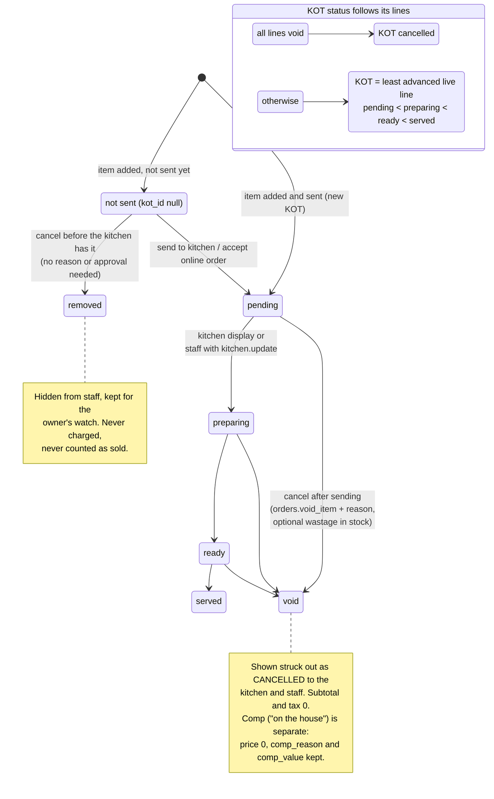
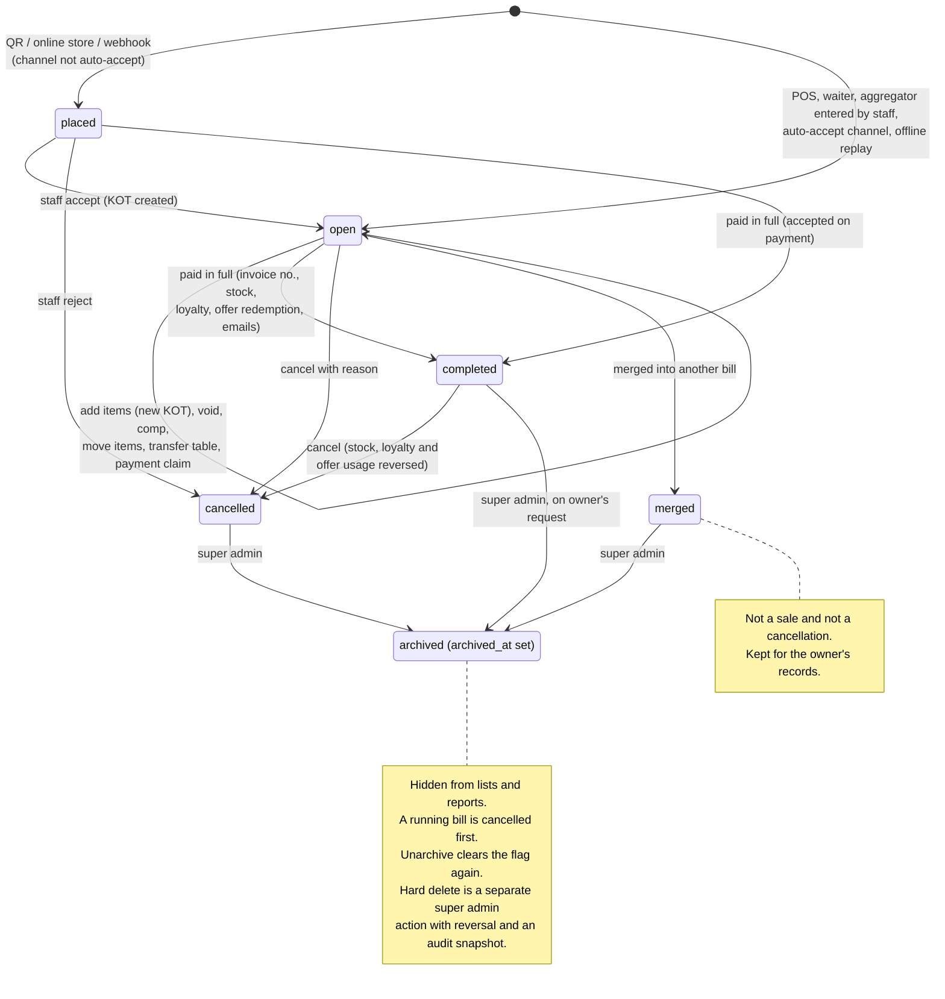

# 017 · Running Bills on the Floor

Restaurants change orders all the time. This module covers what happens between "order taken" and "bill paid", from a one-person café to a large restaurant.

## Situations covered

| Situation | What Tallyko does |
|---|---|
| "Two more rotis" | Add items to the running bill. They go to the kitchen as a **new KOT**; the earlier rotis keep their own status. |
| 4 items, 2 ready, 2 cooking | Every line has its own kitchen status: Pending → Preparing → Ready → Served. A ticket shows the slowest line. |
| No kitchen screen (owner alone, small café) | Cashiers, waiters and owners mark items ready or served from the bill (permission `kitchen.update`, on by default). |
| Customer cancels 1 of 3 rotis the kitchen already has | Partial cancel. A reason is required, and `orders.void_item` is needed (managers/owners). The kitchen sees the item struck out as **CANCELLED**. Optionally book it as wastage in stock. It is never charged. |
| Item not sent to the kitchen yet | Removed straight away; no reason or approval needed. |
| On the house (birthday, complaint) | Complimentary line: price 0, reason and normal value kept for reports. Needs `orders.discount`. |
| Two parties at one table | Several bills per table ("Bill 2", or a guest's name). Opening a second bill is explicit, so nobody adds to the wrong bill by accident. |
| "Separate bills please" | Move selected items, or part of a line, to another bill or to a new bill on the same table. |
| Tables pushed together / one person pays for all | Merge bills. The emptied bill is kept as **merged** (not a sale, not a cancellation). |
| Party moves to a busy table | Transfer a bill; it joins as an extra bill on that table. |
| A waiter covers a colleague's table | Staff who can see tables can open and serve **every running table bill**. Closed bills of others stay private unless `orders.view_all`. |
| Bill made offline on a table that got another bill meanwhile | It syncs as a separate bill on that table; it is never lost. |

## Item and ticket status

<!-- diagram: 07_kitchen_item_status drawio=Tallyko_Order_Flow -->

*Diagram source: [`07_kitchen_item_status.mmd`](../diagrams/mermaid/07_kitchen_item_status.mmd) · [SVG](../diagrams/rendered/07_kitchen_item_status.svg) · draw.io: [`Tallyko_Order_Flow.drawio`](../diagrams/Tallyko_Order_Flow.drawio)*
<!-- /diagram -->

## Bill states

<!-- diagram: 06_order_lifecycle drawio=Tallyko_Order_Flow -->

*Diagram source: [`06_order_lifecycle.mmd`](../diagrams/mermaid/06_order_lifecycle.mmd) · [SVG](../diagrams/rendered/06_order_lifecycle.svg) · draw.io: [`Tallyko_Order_Flow.drawio`](../diagrams/Tallyko_Order_Flow.drawio)*
<!-- /diagram -->

## Rules that protect the money

- Items can't be moved, cancelled or comped after a payment has been taken on that bill. Use cancel or refund for the whole bill.
- Every change re-prices the affected bills with the same engine: GST snapshot, offers re-checked, manual discount kept.
- Reports, stock and GST summaries ignore cancelled lines.
- Every cancel, comp, split and merge goes to the activity log with who did it and why.

## API

- `POST /orders/{id}/items/status`: set the kitchen status of items.
- `POST /orders/{id}/items/void`: cancel items.
- `POST /orders/{id}/items/comp`: on the house.
- `POST /orders/{id}/items/move`: split a bill.
- `POST /orders/{id}/merge`: merge bills.
- `PUT /orders/{id}/details`: change the bill label or guest count.
- `POST /orders` with `new_bill: true` opens a second bill on an occupied table.
- `GET /tables` returns `open_bills` per table, with kitchen progress counts.

The logic lives in `backend/app/services/floor_service.py`, with tests in `backend/tests/integration/test_floor.py`.
