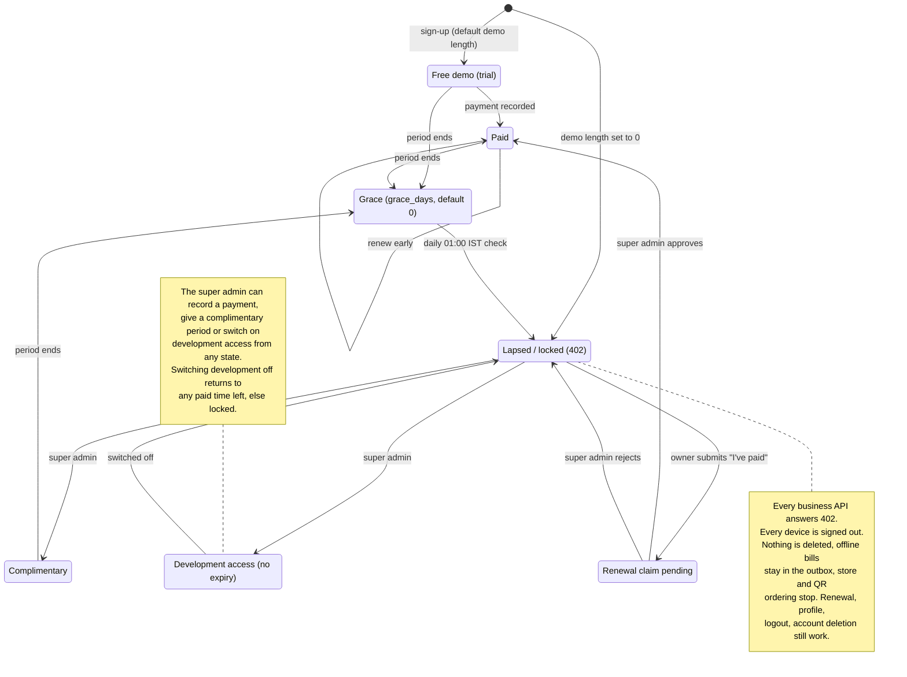
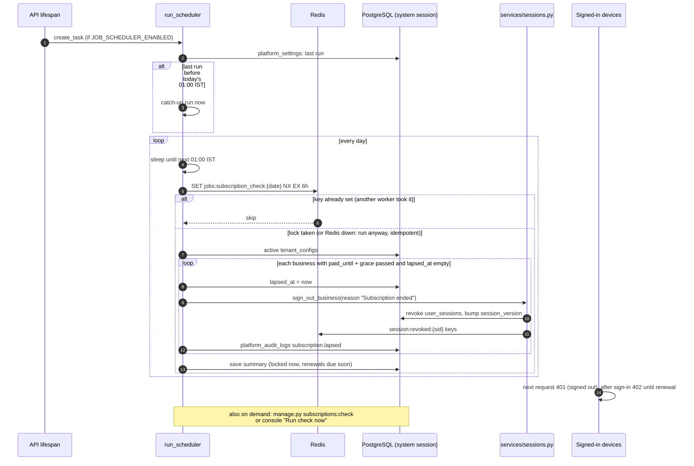

# 018 · Tallyko Subscriptions, Free Demo, Development Access & Sessions

## Access rule

A business works while it has a running subscription period. Periods come in four kinds:

| Kind | How it starts | Ends |
|---|---|---|
| **Free demo** (`trial`) | Automatically at sign-up, or "Give demo" in the console | After the demo length. The super admin sets the default (7, 14, 30 days… or 0 for none) and can give or extend any business's demo |
| **Paid** | Super admin records a payment, or approves an owner's "I've paid" claim | After the months bought (+ any offer's extra days) |
| **Complimentary** | Super admin (goodwill, partners) | After the chosen months |
| **Development** | Super admin switches on "Development access" for any owner | Never, until switched off. For our own testing and pilot shops while the product is being built |

New periods continue from the current end date, so renewing early never loses days.

When the last period ends, the **grace days** (platform setting, default 0) start. After those, the business is **locked**:

- Every business API answers **402**, and the app shows the **renewal screen**: plans, offers, how to pay (UPI / bank), and "I've paid" with a reference number.
- The public online store and QR menu stop taking orders.
- **Nothing is deleted.** Data stays on the server, and bills a device made offline stay in that device's outbox. They sync as soon as the business renews.
- Staff see "Ask the owner to renew". Only the owner can claim a payment.

<!-- diagram: 10_subscription_lifecycle drawio=Tallyko_Subscriptions_Lifecycle -->

*Diagram source: [`10_subscription_lifecycle.mmd`](../diagrams/mermaid/10_subscription_lifecycle.mmd) · [SVG](../diagrams/rendered/10_subscription_lifecycle.svg) · draw.io: [`Tallyko_Subscriptions_Lifecycle.drawio`](../diagrams/Tallyko_Subscriptions_Lifecycle.drawio)*
<!-- /diagram -->

## The daily check (01:00 India time)

The API runs a scheduler. Every day at 01:00 IST it finds businesses whose subscription (plus grace) has just ended and **signs out every device**, so open screens close too. It also records the action in the platform audit log.

- If several API servers run, a Redis lock lets only one of them do the day's check.
- If the server was down at 01:00, the check runs when it starts.
- It is safe to run again: `python manage.py subscriptions:check`, or **Run check now** in the console.
- Settings: `JOB_SCHEDULER_ENABLED`; the schedule and last run are under Console → Settings.

<!-- diagram: 11_daily_subscription_check drawio=Tallyko_Subscriptions_Lifecycle -->

*Diagram source: [`11_daily_subscription_check.mmd`](../diagrams/mermaid/11_daily_subscription_check.mmd) · [SVG](../diagrams/rendered/11_daily_subscription_check.svg) · draw.io: [`Tallyko_Subscriptions_Lifecycle.drawio`](../diagrams/Tallyko_Subscriptions_Lifecycle.drawio)*
<!-- /diagram -->

## Sessions (signed-in devices)

Every sign-in is a session. Tokens carry its id and the business's session version.

| Action | Effect |
|---|---|
| Owner or user: Account → Signed-in devices → Sign out | That device stops working on its next request |
| Super admin: Business → Devices → Sign out / Sign out everywhere | One device, or every device of the business (reason recorded) |
| Password change | Every other device of that login is signed out |
| Staff deactivated, role changed or password reset | That person's devices are signed out immediately |
| Signing out in the app | Also ends the session on the server |

## Selling the subscription

- **Plans** have pricing options, e.g. 1 month ₹799 or 12 months ₹7,990 ("2 months free"). Without options, the price is monthly × months.
- **Subscription offers** (console → Offers):
  - % off, ₹ off, or extra free days;
  - limited to some plans or a minimum number of months;
  - start and end dates, a usage cap;
  - "first paid subscription only";
  - shown on the renewal screen, or code-only.
- **Payments** are recorded manually: there is no payment gateway, because only free services are used. The owner pays by UPI or bank transfer and submits the reference. The super admin checks it and approves (business unlocks instantly) or rejects (with a reason the owner sees).
- Every subscription stores an immutable snapshot: plan, features, limits, list price, discount, offer, amount and who recorded it.

## Code

- `backend/app/services/subscription.py`: states, pricing, offers, recording, the daily check.
- `backend/app/services/sessions.py`.
- `backend/app/api/subscription.py`: owner side.
- `backend/app/api/platform.py`: console.
- Tests: `backend/tests/integration/test_subscriptions.py`.

Where these checks sit in every request (401 signed out, 402 locked): [03_request_pipeline](../diagrams/mermaid/03_request_pipeline.mmd) · draw.io: [`Tallyko_Access_And_Sessions.drawio`](../diagrams/Tallyko_Access_And_Sessions.drawio).
