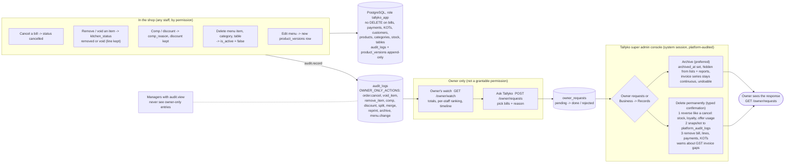
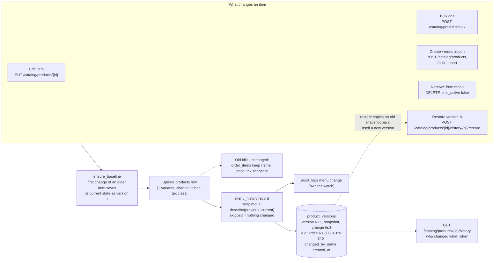

# 019 · Owner's Watch, Nothing-Gets-Deleted, Menu History

## Why

In a small shop the owner is often away while a manager or staff run the counter. They take orders, make bills, cancel bills and remove items. The owner needs to see all of it, and nobody in the shop must be able to hide it.

## What the owner gets: Owner's watch

This page is **owner only**. It is not a permission that can be given to a manager or staff member, and they don't see it. For any period it shows:

- Bills cancelled: how many, worth how much, the reason, and who cancelled them.
- Items **removed before** they reached the kitchen, and items **cancelled after** the kitchen had them, with quantity, value, reason and who.
- Items given on the house, and discounts.
- Menu changes, such as "Butter Chicken: price ₹300 → ₹340, by Anil (manager)".
- A breakdown **per staff member**, ranked by money taken off bills.
- A full timeline of these actions.

Managers who can read the activity log never see these entries. They stay on the owner's page only.

## Nothing gets deleted

- Cancelling a bill sets its status to cancelled. Removing an item marks the line `removed` or, once the kitchen has it, `void`. It disappears from staff screens but stays in the database for the owner, and it is never charged, counted as sold or taken from stock.
- Deleting a menu item, category or table switches it off; it is not erased.
- **The database enforces this.** The app's database role has no DELETE on bills, payments, kitchen tickets, customers, products, categories, stock movements or tables. It cannot UPDATE or DELETE the activity log or the menu history (migration `0059`). A bug or a curious staff member can't erase anything, and neither can the owner.

## Corrections: only Tallyko

- An owner who needs a record gone, such as test bills made while training staff, uses **Owner's watch → Ask Tallyko**. They choose the bills and say why.
- Tallyko's super admin handles it in the console (Owner requests, or Business → Records), and the owner sees the response.
  - **Archive (preferred):** the bill stays in the database but leaves lists and reports. GST invoice numbers stay continuous, and it can be undone.
  - **Delete permanently:** this needs a typed confirmation. It first reverses the bill's effect on stock, loyalty points and offer usage, as a cancellation does. Then it removes the bill and its lines, payments and tickets. A full snapshot of what was deleted, and by whom, stays in the platform audit log. Deleting issued tax invoices leaves gaps in the GST invoice series; the console warns about this.

<!-- diagram: 12_records_and_watch drawio=Tallyko_Records_And_Audit -->

*Diagram source: [`12_records_and_watch.mmd`](../diagrams/mermaid/12_records_and_watch.mmd) · [SVG](../diagrams/rendered/12_records_and_watch.svg) · draw.io: [`Tallyko_Records_And_Audit.drawio`](../diagrams/Tallyko_Records_And_Audit.drawio)*
<!-- /diagram -->

## Menu history (versioning)

- Every change to a menu item is saved as a new version: created, price change, rename, option prices, tax class, app prices, removed from or back on the menu.
- Each version records who made the change, when, and a plain description.
- Any version can be restored; the restore is itself a new version.
- Old bills never change: each bill line keeps its own price snapshot.
- API: `GET /catalog/products/{id}/history`, `POST /catalog/products/{id}/history/{version}/restore`.

<!-- diagram: 13_menu_versioning drawio=Tallyko_Records_And_Audit -->

*Diagram source: [`13_menu_versioning.mmd`](../diagrams/mermaid/13_menu_versioning.mmd) · [SVG](../diagrams/rendered/13_menu_versioning.svg) · draw.io: [`Tallyko_Records_And_Audit.drawio`](../diagrams/Tallyko_Records_And_Audit.drawio)*
<!-- /diagram -->

## GST only with a valid GSTIN

GST is added to bills only when the business is **GST-registered (regular)** and has a **valid GSTIN**. Validation checks:

- 15 characters;
- a known state code;
- the PAN pattern;
- the official mod-36 check character, which catches typos.

| Business | Bill | GST |
|---|---|---|
| Regular + valid GSTIN | Tax invoice | Yes (CGST + SGST, or IGST) |
| Regular, GSTIN missing | Bill of Supply | No, with a warning to add the GSTIN |
| Composition (needs a valid GSTIN) | Bill of Supply | No |
| Not registered | Bill of Supply | No |

Settings refuse an invalid GSTIN, and refuse "Regular" or "Composition" without one. The device's offline price preview follows the same rule.

## Code and tests

- Owner's watch: `backend/app/api/owner.py`.
- Owner-only actions: `app/services/audit.py` (`OWNER_ONLY_ACTIONS`).
- Records admin: `app/services/records_admin.py`.
- Menu history: `app/services/menu_history.py`.
- GSTIN validation: `app/core/gstin.py`.
- Tests: `tests/integration/test_owner_controls.py`.
